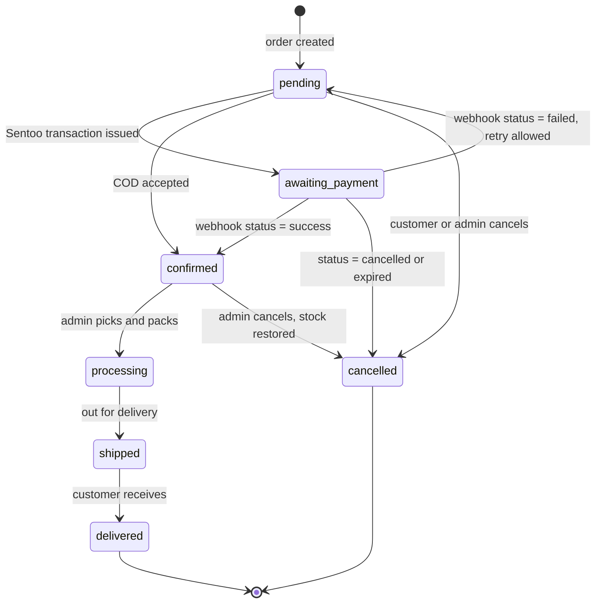
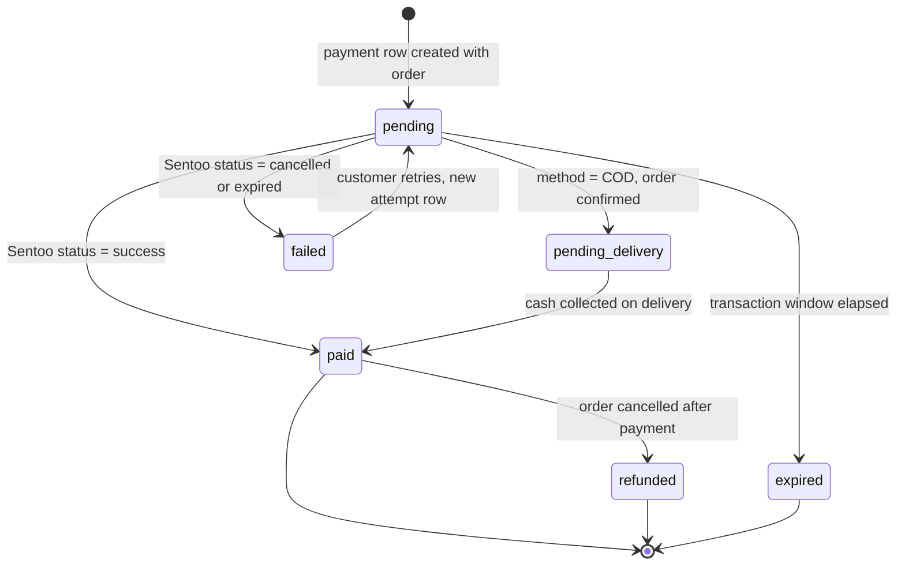
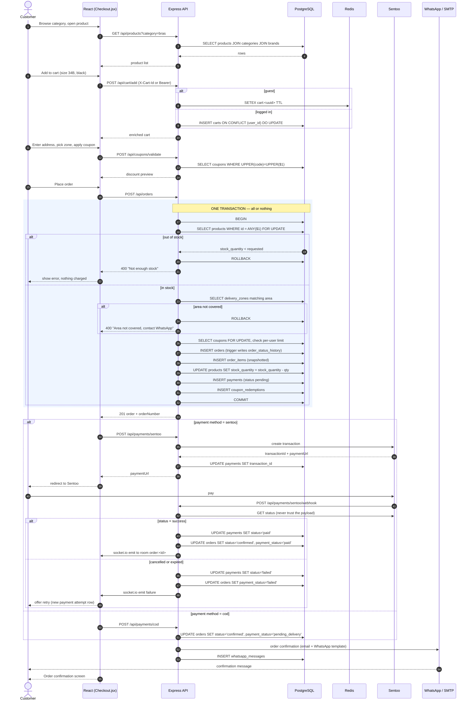
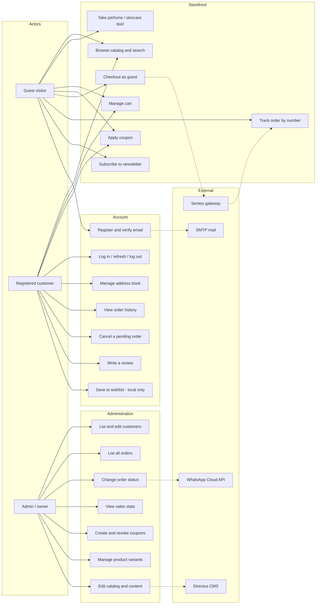
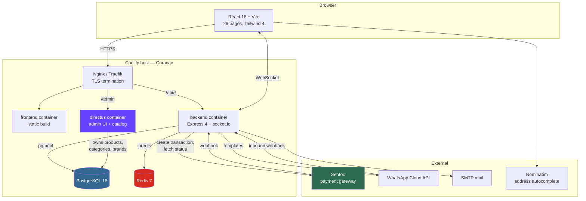

# Unistyles Curaçao — Complete Database Architecture

**Date:** 21 August 2026
**Analysed from:** the actual repository (`services/backend`, `services/frontend`, `services/directus`, `database/`), not from a generic e-commerce template.
**Deliverables produced:** this document, `database/init.v2.sql`, `database/seed-example.sql`.

---

## Table of contents

1. [Architecture assessment](#1-architecture-assessment)
2. [Recommended database technology](#2-recommended-database-technology)
3. [Complete entity list](#3-complete-entity-list)
4. [Detailed table definitions](#4-detailed-table-definitions)
5. [Complete ERD (Mermaid)](#5-complete-erd-mermaid)
6. [UML domain model (Mermaid)](#6-uml-domain-model-mermaid)
7. [Complete SQL](#7-complete-sql)
8. [Seed data](#8-seed-data)
9. [Backend route → database mapping](#9-backend-route--database-mapping)
10. [Frontend → backend → database data flows](#10-frontend--backend--database-data-flows)
11. [Indexing strategy](#11-indexing-strategy)
12. [Security considerations](#12-security-considerations)
13. [Required now vs optional later](#13-required-now-vs-optional-later)
14. [Final implementation checklist](#14-final-implementation-checklist)

---

## 1. Architecture assessment

### 1.1 What the project actually is

The structure you described is roughly right but the repository has moved on from it. The real layout:

```text
unistyles-website-v2/
├── services/
│   ├── frontend/     React 18 + Vite 5 + Tailwind 4, 28 pages
│   ├── backend/      Express 4 + node-pg + ioredis + socket.io, 16 route files
│   └── directus/     Directus CMS — owns the product catalog (bootstrap.js)
├── database/         init.sql + 4 migrations
├── deploy/           Coolify deployment configs
└── docs/
```

Backend routes actually present — **nine more than in your list**:

`auth, products, categories, cart, orders, payments, users` **plus** `admin, coupons, delivery, newsletter, perfumes, reviews, skincare, variants, whatsapp`.

### 1.2 The single most important architectural fact

**The product catalog does not live in `database/init.sql`. It lives in Directus, in the same PostgreSQL database.**

`services/directus/bootstrap.js` creates `products`, `categories`, `brands`, `pages`, `customers`, `business_settings` and `homepage` as Directus collections. The Express API then queries those tables *directly with SQL* — for example `services/backend/src/routes/products.js:96` joins `products → categories → brands`, and `services/backend/src/routes/orders.js:60` does `SELECT … FROM products … FOR UPDATE`.

So the database has **two owners**:

| Owner | Tables |
|---|---|
| `database/init.sql` | users, addresses, orders, order_items, payments, carts, reviews, coupons, product_variants, delivery_zones, newsletter_subscribers, settings, whatsapp_messages |
| `services/directus/bootstrap.js` | products, categories, brands, pages, customers, business_settings, homepage, `directus_*` system tables |

The comment at `database/init.sql:46` still says *"Categories and Products are managed by Strapi CMS"* — that is stale; the project migrated Strapi → Directus in commit `050c0bd`. Any schema work must respect this split or the two systems will fight over the same table names.

### 1.3 Defects found in the current schema

These are real, verified against the code — not hypotheticals.

| # | Defect | Evidence | Consequence |
|---|---|---|---|
| 1 | `reviews.product_id` is `UUID`, but the API inserts an **integer** | `init.sql:150` vs `reviews.js:100` (`body('productId').isInt()`) and `reviews.js:147` | **Every review submission fails** with a Postgres type error. The reviews feature is dead on arrival. |
| 2 | `order_items.variant_id` is `INTEGER`, but `product_variants.id` is `UUID` | `init.sql:97` vs `init.sql:214` | A variant can never be linked to an order line. Size/colour on an order survives only as free text. |
| 3 | Stock is tracked in **two places** | `products.stock_quantity` (decremented in `orders.js:222`) and `product_variants.stock_quantity` (`init.sql:220`, managed by `variants.js`) | Selling a 34B bra decrements the *product* total, never the variant. Variant stock drifts permanently out of true. |
| 4 | No foreign keys from `order_items` / `reviews` / `product_variants` to `products` | no `REFERENCES` in `init.sql` | Orphan rows accumulate silently; nothing stops a typo'd product id. |
| 5 | `order_number` generated with `RANDOM()` | `init.sql:270` | Only 10 000 combinations per day against a `UNIQUE` constraint. At ~50 orders/day there is roughly a 12 % chance of at least one collision per day — and a collision **fails the customer's checkout**. |
| 6 | Coupons have no per-customer redemption record | `coupons` table, `orders.js:139` | `WELCOME10` — "10 % off your **first** order" — can be reused by the same customer forever. Also `orders` stores the discount *amount* but not *which coupon*, so coupon performance cannot be reported. |
| 7 | Cancelling an order does not release the coupon | `orders.js:495-530` restores stock only | `times_used` inflates; a limited-run coupon burns out on cancelled orders. |
| 8 | No order status history table | `TrackOrder.jsx` + `orders.js:429` return only the *current* status | The tracking page can show "shipped" but never "confirmed 10:04, shipped 14:20". Also no audit trail of who changed what. |
| 9 | Payment-method value mismatch between frontend and backend | frontend `constants.js:113` sends `'bank'`; backend validator accepts `'bank_transfer'` (`orders.js:21`) | **Selecting Bank Transfer at checkout returns a 400 validation error.** |
| 10 | `reviews` uniqueness enforced only in application code | `reviews.js:115` `SELECT` then `INSERT` | Two concurrent submissions both pass the check and both insert. |
| 11 | Business configuration exists in **three** places | frontend `constants.js`, Postgres `settings`, Directus `business_settings` | Categories, payment methods, delivery thresholds and business hours can disagree with each other. |
| 12 | No `CHECK` constraints on order/payment status or on money | `init.sql:57-70` | A typo'd status (`'shiped'`) is accepted; `total` can disagree with `subtotal + fee − discount`. |

### 1.4 What the current schema gets right

Worth saying plainly, because these are the decisions people usually get wrong:

- `orders.shipping_address` is **JSONB, not a foreign key** — the delivery address is correctly frozen at purchase time.
- `order_items` already snapshots `product_name`, `product_sku`, `price`, `size`, `color`, `image_url`.
- Checkout runs inside a real transaction with `SELECT … FOR UPDATE` row locks (`orders.js:56-249`) — two customers cannot buy the same last item.
- Coupon application uses `FOR UPDATE` before incrementing `times_used`.
- The Sentoo webhook never trusts the payload's status; it re-fetches from the Sentoo API (`payments.js:209`).
- JWT logout uses a Redis blacklist with a TTL matched to the token's own expiry.

The v2 schema keeps all of this and fixes the twelve defects above.

---

## 2. Recommended database technology

**PostgreSQL 16 — keep it. Do not migrate.**

| | PostgreSQL | MySQL | MongoDB |
|---|---|---|---|
| Multi-row transactions in checkout | Mature, `SELECT … FOR UPDATE` used already | Comparable | Possible but awkward; needs a replica set |
| `JSONB` for address/cart/provider-response snapshots | First class, indexable with GIN | JSON type is weaker, no GIN | Native — but this is the *only* category it wins |
| Money accuracy | `DECIMAL(10,2)`, exact | `DECIMAL`, exact | No native decimal in the default driver path — a real risk for prices |
| Foreign keys & CHECK constraints | Full | Full (CHECK since 8.0.16) | None — integrity would move into application code |
| Directus support | Best-supported target | Supported | Not supported |
| Partial & expression indexes (`WHERE is_approved = TRUE`, `UPPER(code)`) | Yes | No | Partial only |

**Why it fits this specific application:**

- **Orders and payments** need atomic multi-table writes (order + items + stock decrement + payment row). This already works in `orders.js` and only Postgres/MySQL make it easy.
- **Products and variants** are a clean relational hierarchy with wildly varying attributes per category (perfume has `fragrance_family`, skincare has `spf`). Directus models these as nullable columns on one wide `products` table — workable in Postgres, painful in MySQL, and it's precisely the case where people wrongly reach for MongoDB.
- **Data integrity** is the whole point here: this is a real shop taking real money in XCG. Foreign keys and CHECK constraints are the cheapest bug-prevention available, and MongoDB has neither.
- **Directus requires it.** Migrating away means rebuilding the CMS.

> **Enums:** use `VARCHAR + CHECK`, not Postgres `ENUM` types. Adding a status to an `ENUM` requires `ALTER TYPE` and cannot be rolled back inside a transaction cleanly; a `CHECK` constraint is edited with one `ALTER TABLE`. For a shop this size the flexibility is worth more than the two bytes saved.

---

## 3. Complete entity list

### 3.1 Owned by `database/init.v2.sql` — 15 tables

| # | Table | One-line purpose |
|---|---|---|
| 1 | `users` | Customer accounts and the owner's admin login (`Register.jsx`, `Login.jsx`, `Profile.jsx`, `Admin.jsx`). |
| 2 | `delivery_zones` | The three Curaçao zones with their fee, free-shipping threshold and neighbourhood list — the single source of delivery pricing. |
| 3 | `addresses` | A customer's saved address book, geocoded to a zone (`Profile.jsx`, `users.js`). |
| 4 | `carts` | Server-side cart for logged-in customers; guests use Redis. |
| 5 | `coupons` | Discount code definitions (`coupons.js`, checkout coupon box). |
| 6 | `orders` | The transaction record — money, status and a frozen delivery snapshot. |
| 7 | `order_items` | Line items with a full snapshot of name, SKU, price, size and colour. |
| 8 | `order_status_history` | **New.** Every status transition, for `TrackOrder.jsx` and the admin audit trail. |
| 9 | `payments` | One row per payment attempt; Sentoo transaction reference, never card data. |
| 10 | `coupon_redemptions` | **New.** Who redeemed which coupon on which order — makes "first order only" enforceable. |
| 11 | `product_variants` | Size/colour SKUs with their own stock, for bras, panties and shapewear. |
| 12 | `reviews` | Star ratings and comments, with a verified-purchase flag and a moderation gate. |
| 13 | `newsletter_subscribers` | Email capture from the footer form. |
| 14 | `settings` | Operational key/value settings the API must read inside a transaction (e.g. `free_delivery_threshold`). |
| 15 | `whatsapp_messages` | Log of outbound order notifications and inbound webhook messages. |

### 3.2 Owned by Directus — do not create these in SQL

| Table | Purpose | Key fields used by the API |
|---|---|---|
| `products` | The 285-product catalog | `id, name, slug, ref, description, price, compare_at_price, image, gallery, color, size, style, material, badge, in_stock, stock_quantity, featured, sort_order, legacy_image, category_id, brand_id` + perfume fields (`gender, fragrance_family, top_notes, …`) + skincare fields (`skin_type, spf, texture, …`) |
| `categories` | 9 categories | `id, name, slug, description, image, filter_type, filters, sort_order, show_in_menu` |
| `brands` | Avon, Cyzone, Ésika, L'Bel, Yanbal | `id, name, slug, logo, country, featured` |
| `pages` | About / FAQ / Terms / Privacy content | `title, slug, content, seo_*` |
| `business_settings` | Branding singleton | `store_name, logo, whatsapp_number, social_links, …` |
| `homepage` | Hero slides, featured blocks | JSON arrays |
| `directus_files` | Uploaded images | referenced by `products.image` (UUID) |
| `customers` | Directus-side mirror of customers | `postgres_id` links back to `users.id` — **see §13, this is a duplicate source of truth and should be dropped** |

### 3.3 Entities deliberately **not** created — and why

| Not created | Why not |
|---|---|
| `sessions`, `refresh_tokens` | Authentication is stateless JWT with a **Redis** blacklist for logout (`middleware/auth.js:24-49`). A sessions table would add a database write to every request and buy nothing. |
| `password_reset_tokens`, `email_verification_tokens` | Both are short-lived signed JWTs, single-use via the same Redis blacklist (`auth.js:114-140`). |
| `product_images` | Directus already owns images: `products.image` (UUID → `directus_files`) plus a `gallery` JSON array plus `legacy_image` for the static `/images/**` files. A third image store would be a fourth source of truth. |
| `inventory` | With 285 products and one physical stock location, a separate inventory table is pure ceremony. Stock lives on `products.stock_quantity`, or on `product_variants.stock_quantity` where variants exist. |
| `shipments`, `carriers` | Unistyles delivers its own orders across a 444 km² island. There is no carrier, no tracking number, no split shipment. `order_status_history` covers everything `TrackOrder.jsx` shows. Add later only if a courier is introduced. |
| `roles`, `permissions` | Two roles exist: customer and owner. `users.is_admin` is correct at this scale; a role table is justified when a third distinct role appears (e.g. a delivery driver login). |
| `categories` / `payment_methods` as new SQL tables | `categories` already exists in Directus. Payment methods are a fixed list of three the code branches on explicitly — putting them in a table would not make them dynamic. |
| `taxes` | Curaçao OB is included in the shelf price and Unistyles is below the turnover threshold for separate line-item tax. Revisit only if that changes. |

---

## 4. Detailed table definitions

Full DDL is in `database/init.v2.sql`. This section states each table's purpose, its keys, and the reasoning that is not obvious from the SQL.

### users
Customer accounts and the admin login.

| Column | Type | Null | Default | Notes |
|---|---|---|---|---|
| `id` | UUID | NOT NULL | `uuid_generate_v4()` | **PK** |
| `email` | CITEXT | NOT NULL | — | **UNIQUE**. `CITEXT` so `Paula@…` and `paula@…` are the same account — the current `VARCHAR` lets both register. |
| `password_hash` | VARCHAR(255) | NOT NULL | — | bcrypt cost 12 (`auth.js:46`). Never a plaintext password. |
| `first_name`, `last_name` | VARCHAR(100) | NULL | — | |
| `phone` | VARCHAR(20) | NULL | — | |
| `is_admin` | BOOLEAN | NOT NULL | `FALSE` | Re-verified from the database on sensitive routes, never trusted from the JWT (`orders.js:372`). |
| `is_verified` | BOOLEAN | NOT NULL | `FALSE` | Email confirmed. |
| `last_login_at` | TIMESTAMPTZ | NULL | — | New — lets you spot dormant accounts. |
| `deleted_at` | TIMESTAMPTZ | NULL | — | **Soft delete.** Hard-deleting a customer would `SET NULL` their orders and lose the link to their purchase history. |
| `created_at`/`updated_at` | TIMESTAMPTZ | NOT NULL | `NOW()` | `updated_at` maintained by trigger. |

**Indexes:** `idx_users_email` (partial, `deleted_at IS NULL`), `idx_users_admin` (partial, `is_admin = TRUE`).

### delivery_zones
The pricing authority for delivery. Zone fees were derived from real Curaçao fuel and labour costs, and each zone carries its own free-shipping threshold so far-out deliveries do not lose money.

**PK** `id SERIAL` · **UNIQUE** `slug` · `neighborhoods JSONB` is `[{name, desc}]` and is GIN-indexed because `orders.js:108` searches inside it with `jsonb_array_elements` on every checkout.

**Why `SERIAL` and not UUID:** three rows that a human reads and edits. Integer keys are far friendlier here, and `orders.delivery_zone_id` already expects an integer.

### addresses
The customer's saved address book. **This is not where an order's delivery address lives** — see `orders.shipping_address`.

**PK** `id UUID` · **FK** `user_id → users(id) ON DELETE CASCADE`, `delivery_zone_id → delivery_zones(id) ON DELETE SET NULL`
**New constraint:** a partial unique index guarantees at most one `is_default = TRUE` address per customer — currently nothing prevents three "default" addresses.
**New CHECKs:** latitude ∈ [−90, 90], longitude ∈ [−180, 180].

### carts
Cart for logged-in customers only.

**PK** `id UUID` · **UNIQUE FK** `user_id` (the API relies on `ON CONFLICT (user_id) DO UPDATE`, `cart.js:134-137`).
`items JSONB` holds `[{productId, variantId, quantity, size, color}]`. **Prices are deliberately absent** — checkout re-reads the live price from `products` under a row lock, so a stale cart can never lock in an old price.

**Why JSONB and not a `cart_items` table:** a cart is a scratchpad, not a business record. It is read and rewritten wholesale on every mutation, it is never joined or reported on, and it is discarded at checkout. A child table would add joins and an id lifecycle for zero benefit. The moment a cart needs reporting ("abandoned cart" emails), revisit this.

### coupons
**PK** `id UUID` · **UNIQUE** `UPPER(code)` — the API compares case-insensitively (`orders.js:141`), so the uniqueness must be case-insensitive too, otherwise `welcome10` and `WELCOME10` coexist as different coupons.
**New:** `max_uses_per_user` (default 1), `updated_at`.
**New CHECKs:** percentage discounts ≤ 100; `valid_until > valid_from`; `discount_value > 0`.

### orders
The transaction record.

| Group | Columns | Notes |
|---|---|---|
| Identity | `id` PK, `order_number` UNIQUE | `UNI-YYMMDD-NNNN`, now **sequence-backed** instead of `RANDOM()`. |
| Customer | `user_id` FK → users **ON DELETE SET NULL**, `guest_email`, `guest_phone`, `guest_name` | Contact details are copied onto every order, guest or not, so the order survives account deletion. **CHECK** guarantees at least one contact route exists. |
| Status | `status`, `payment_method`, `payment_status` | All three now **CHECK-constrained** to the exact values the code uses. |
| Money | `subtotal`, `delivery_fee`, `discount`, `total`, `currency` | **CHECK `total = subtotal + delivery_fee − discount`** — arithmetic bugs become impossible to persist. |
| Coupon | `coupon_id` FK **ON DELETE SET NULL**, `coupon_code` snapshot | New. Reporting via the FK, readability via the snapshot. |
| Delivery | `shipping_address` JSONB, `delivery_zone_id`, `delivery_zone_name`, `delivery_lat/lng`, `delivery_date`, `delivery_time_slot` | `shipping_address` is the **frozen snapshot**. `delivery_zone_name` is snapshotted too, so renaming a zone does not rewrite old invoices. |
| Notes | `notes` (customer), `admin_notes` (internal) | `admin_notes` must never be returned by a customer-facing endpoint. |

### order_items
Line items. **Every field an invoice needs is snapshotted**: `product_name`, `product_sku`, `price`, `size`, `color`, `image_url`.

`product_id` and `variant_id` are **reporting links only**, both `ON DELETE SET NULL`. Deleting a product in Directus nulls the link but leaves the order line fully readable.
**New:** `line_total` as a `GENERATED ALWAYS AS (price * quantity) STORED` column — the database computes it, so it can never disagree with the parts.
**Fixed:** `variant_id` is now `UUID`, matching `product_variants.id`.

### order_status_history *(new)*
| Column | Type | Notes |
|---|---|---|
| `id` | BIGSERIAL | PK — append-only log, integer is right |
| `order_id` | UUID | FK → orders ON DELETE CASCADE |
| `from_status` / `to_status` | VARCHAR(30) | |
| `note` | TEXT | |
| `changed_by` | UUID | FK → users, NULL = system/webhook |
| `created_at` | TIMESTAMPTZ | |

**Written by a database trigger**, not by application code. Any path that changes `orders.status` — admin panel, Sentoo webhook, cancellation, a manual `psql` fix — is recorded automatically. This is the difference between an audit trail and an audit trail with holes.

### payments
One row **per attempt**, not per order — a customer whose card is declined and who then retries produces two rows, and you keep both.

**UNIQUE (partial)** on `transaction_id WHERE NOT NULL` — the Sentoo webhook looks payments up by this value (`payments.js:190`); without uniqueness a replayed webhook could match the wrong row.
**New:** `provider`, `failure_reason`, `paid_at`.
**Never stored:** card number, CVV, expiry, cardholder name. `provider_response` holds Sentoo's status payload only.

### coupon_redemptions *(new)*
`coupon_id`, `order_id` (UNIQUE — one coupon per order), `user_id` or `guest_email`, `amount_saved`.
This is what makes `max_uses_per_user` enforceable, lets a cancellation release the redemption, and answers "did BEAUTY20 actually drive sales?".

### product_variants
**Fixed:** `product_id` is `INTEGER` with a real FK to `products(id) ON DELETE CASCADE`.
**New:** unique index on `(product_id, size, color)` — no duplicate 34B/black rows; unique `sku` where present.
**Stock rule:** when a product has variants, **the variant owns the stock**. See §13 for the code change this requires.

### reviews
**Fixed:** `product_id` is `INTEGER` with an FK — this alone makes the reviews feature work at all.
**New:** unique index on `(product_id, user_id)` so the "already reviewed" check is enforced by the database rather than by a racy `SELECT`-then-`INSERT`.
`is_verified` = bought it in a delivered order. `is_approved` = passed moderation; the public listing filters on it via a partial index.

### newsletter_subscribers · settings · whatsapp_messages
- `newsletter_subscribers`: `email CITEXT UNIQUE`, plus a CHECK that an inactive subscriber has an `unsubscribed_at` date.
- `settings`: key/value JSONB, **scoped down** to values the API reads inside transactions. Branding moves to Directus (§13).
- `whatsapp_messages`: **new unique index on `wamid`** — Meta redelivers webhooks, and without it every redelivery duplicates a row.

---

## 5. Complete ERD (Mermaid)

```mermaid
erDiagram
    USERS ||--o{ ADDRESSES : "saves"
    USERS ||--o| CARTS : "has one"
    USERS ||--o{ ORDERS : "places"
    USERS ||--o{ REVIEWS : "writes"
    USERS ||--o{ COUPON_REDEMPTIONS : "redeems"
    USERS ||--o{ ORDER_STATUS_HISTORY : "changes"

    DELIVERY_ZONES ||--o{ ADDRESSES : "geocodes to"
    DELIVERY_ZONES ||--o{ ORDERS : "prices"

    ORDERS ||--|{ ORDER_ITEMS : "contains"
    ORDERS ||--o{ PAYMENTS : "is paid by"
    ORDERS ||--o{ ORDER_STATUS_HISTORY : "logs"
    ORDERS ||--o| COUPON_REDEMPTIONS : "redeems"
    ORDERS ||--o{ WHATSAPP_MESSAGES : "notifies about"
    ORDERS ||--o{ REVIEWS : "enables"

    COUPONS ||--o{ ORDERS : "discounts"
    COUPONS ||--o{ COUPON_REDEMPTIONS : "tracked by"

    PRODUCTS ||--o{ PRODUCT_VARIANTS : "has"
    PRODUCTS ||--o{ ORDER_ITEMS : "sold as"
    PRODUCTS ||--o{ REVIEWS : "reviewed as"
    PRODUCT_VARIANTS ||--o{ ORDER_ITEMS : "sold as"
    CATEGORIES ||--o{ PRODUCTS : "groups"
    BRANDS ||--o{ PRODUCTS : "makes"
    DIRECTUS_FILES ||--o{ PRODUCTS : "illustrates"
    DIRECTUS_FILES ||--o{ CATEGORIES : "illustrates"

    USERS {
        uuid id PK
        citext email UK "case-insensitive"
        varchar password_hash "bcrypt cost 12"
        varchar first_name
        varchar last_name
        varchar phone
        boolean is_admin "default false"
        boolean is_verified "default false"
        timestamptz last_login_at
        timestamptz deleted_at "soft delete"
        timestamptz created_at
        timestamptz updated_at
    }

    ADDRESSES {
        uuid id PK
        uuid user_id FK "CASCADE"
        varchar label "default Home"
        varchar recipient_name
        varchar phone
        varchar street
        varchar area
        varchar city "default Willemstad"
        varchar country "default Curacao"
        text landmark
        decimal latitude
        decimal longitude
        integer delivery_zone_id FK "SET NULL"
        boolean is_default "one per user"
        timestamptz created_at
        timestamptz updated_at
    }

    DELIVERY_ZONES {
        serial id PK
        varchar slug UK
        varchar name
        decimal fee "CHECK >= 0"
        decimal free_threshold "null uses global"
        varchar estimated_days
        varchar color
        integer sort_order
        boolean is_active
        jsonb polygon "GeoJSON phase 2"
        jsonb neighborhoods "GIN indexed"
        timestamptz created_at
        timestamptz updated_at
    }

    CARTS {
        uuid id PK
        uuid user_id FK,UK "CASCADE"
        jsonb items "no prices stored"
        timestamptz created_at
        timestamptz updated_at
    }

    COUPONS {
        uuid id PK
        varchar code UK "UNIQUE on UPPER(code)"
        text description
        varchar discount_type "percentage|fixed"
        decimal discount_value "CHECK > 0"
        decimal min_order_amount
        decimal max_discount
        integer max_uses
        integer max_uses_per_user "default 1"
        integer times_used
        timestamptz valid_from
        timestamptz valid_until
        boolean is_active
        timestamptz created_at
        timestamptz updated_at
    }

    ORDERS {
        uuid id PK
        varchar order_number UK "UNI-YYMMDD-NNNN"
        uuid user_id FK "SET NULL, null=guest"
        varchar guest_email "contact snapshot"
        varchar guest_phone
        varchar guest_name
        varchar status "CHECK 7 values"
        varchar payment_method "CHECK 5 values"
        varchar payment_status "CHECK 7 values"
        decimal subtotal
        decimal delivery_fee
        decimal discount
        decimal total "CHECK = sub+fee-disc"
        varchar currency "default XCG"
        uuid coupon_id FK "SET NULL"
        varchar coupon_code "snapshot"
        jsonb shipping_address "FROZEN SNAPSHOT"
        integer delivery_zone_id FK "SET NULL"
        varchar delivery_zone_name "snapshot"
        decimal delivery_lat
        decimal delivery_lng
        date delivery_date
        varchar delivery_time_slot
        text notes "customer"
        text admin_notes "internal only"
        timestamptz created_at
        timestamptz updated_at
    }

    ORDER_ITEMS {
        uuid id PK
        uuid order_id FK "CASCADE"
        integer product_id FK "SET NULL, reporting only"
        uuid variant_id FK "SET NULL, reporting only"
        varchar product_name "SNAPSHOT"
        varchar product_sku "SNAPSHOT"
        integer quantity "CHECK > 0"
        decimal price "SNAPSHOT unit price"
        varchar size "SNAPSHOT"
        varchar color "SNAPSHOT"
        varchar image_url "SNAPSHOT"
        decimal line_total "GENERATED price*qty"
        timestamptz created_at
    }

    ORDER_STATUS_HISTORY {
        bigserial id PK
        uuid order_id FK "CASCADE"
        varchar from_status
        varchar to_status
        text note
        uuid changed_by FK "null = system"
        timestamptz created_at
    }

    PAYMENTS {
        uuid id PK
        uuid order_id FK "CASCADE"
        varchar method "CHECK 5 values"
        varchar provider "sentoo|manual"
        varchar status "CHECK 7 values"
        decimal amount
        varchar currency
        varchar transaction_id UK "partial unique"
        jsonb provider_response "NO card data"
        text failure_reason
        timestamptz paid_at
        timestamptz created_at
        timestamptz updated_at
    }

    COUPON_REDEMPTIONS {
        uuid id PK
        uuid coupon_id FK "CASCADE"
        uuid order_id FK,UK "CASCADE, one per order"
        uuid user_id FK "SET NULL"
        varchar guest_email
        decimal amount_saved
        timestamptz created_at
    }

    PRODUCT_VARIANTS {
        uuid id PK
        integer product_id FK "CASCADE"
        varchar size
        varchar color
        varchar sku UK
        integer stock_quantity "owns stock"
        decimal price_adjustment
        boolean is_active
        timestamptz created_at
        timestamptz updated_at
    }

    REVIEWS {
        uuid id PK
        integer product_id FK "CASCADE, was UUID BUG"
        uuid user_id FK "SET NULL"
        uuid order_id FK "SET NULL"
        integer rating "CHECK 1-5"
        varchar title
        text comment
        boolean is_verified "delivered purchase"
        boolean is_approved "moderation gate"
        timestamptz created_at
        timestamptz updated_at
    }

    NEWSLETTER_SUBSCRIBERS {
        uuid id PK
        citext email UK
        boolean is_active
        varchar source
        timestamptz subscribed_at
        timestamptz unsubscribed_at
    }

    SETTINGS {
        varchar key PK
        jsonb value
        timestamptz updated_at
    }

    WHATSAPP_MESSAGES {
        uuid id PK
        varchar direction "inbound|outbound"
        varchar phone
        varchar wamid UK "idempotency key"
        varchar message_type
        text content
        varchar template_name
        varchar status
        timestamptz status_timestamp
        uuid order_id FK "SET NULL"
        jsonb metadata
        timestamptz created_at
    }

    PRODUCTS {
        integer id PK "DIRECTUS-OWNED"
        varchar name
        varchar slug
        varchar ref "SKU"
        text description
        decimal price
        decimal compare_at_price
        uuid image FK "directus_files"
        json gallery
        varchar color
        varchar size
        varchar style
        varchar material
        varchar badge
        boolean in_stock
        integer stock_quantity
        boolean featured
        integer sort_order
        varchar legacy_image
        integer category_id FK
        integer brand_id FK
    }

    CATEGORIES {
        integer id PK "DIRECTUS-OWNED"
        varchar name
        varchar slug
        text description
        uuid image FK
        varchar filter_type
        json filters
        integer sort_order
        boolean show_in_menu
    }

    BRANDS {
        integer id PK "DIRECTUS-OWNED"
        varchar name
        varchar slug
        uuid logo FK
        varchar country
        boolean featured
    }

    DIRECTUS_FILES {
        uuid id PK "DIRECTUS-OWNED"
        varchar filename_disk
        varchar type
    }
```



**Reading it:** the five boxes marked `DIRECTUS-OWNED` are created by `services/directus/bootstrap.js`, not by your SQL file — but they live in the same database, so the foreign keys crossing that boundary are real. `PRODUCTS ||--o{ ORDER_ITEMS` reads "one product appears in zero or many order lines". `ORDERS ||--|{ ORDER_ITEMS` uses the double bar deliberately: an order must have **at least one** line item. The relationships from `USERS` are almost all optional (`o{`) because guests can order, and orders outlive deleted accounts.

**Cardinality summary:**

```text
users            1 ────── 0..n  orders            (guest orders have no user)
users            1 ────── 0..1  carts             (UNIQUE user_id)
users            1 ────── 0..n  addresses
orders           1 ────── 1..n  order_items       (at least one)
orders           1 ────── 0..n  payments          (one row per attempt)
orders           1 ────── 0..n  order_status_history
orders           1 ────── 0..1  coupon_redemptions
coupons          1 ────── 0..n  orders
delivery_zones   1 ────── 0..n  orders
products         1 ────── 0..n  product_variants
products         1 ────── 0..n  order_items       (link is nullable — SET NULL on delete)
categories       1 ────── 0..n  products          (one category per product)
brands           1 ────── 0..n  products
```

**Category ↔ Product: one, not many.** Directus models this as `products.category_id` — a single FK — and the API filters on exactly one category slug (`products.js:56`). The nine categories are mutually exclusive by construction (a bra is not a perfume). A many-to-many join table would add a join to every catalog query to model a case that does not exist in this inventory. **Recommendation: keep one-to-many.** If cross-listing ever becomes real ("Gift Sets" containing perfume *and* skincare), add a `product_categories` join table then and keep `category_id` as the primary/canonical category.

---

## 6. UML domain model (Mermaid)

```mermaid
classDiagram
    direction LR

    class User {
        +UUID id
        +String email
        -String passwordHash
        +String firstName
        +String lastName
        +String phone
        +Boolean isAdmin
        +Boolean isVerified
        +DateTime deletedAt
        +register(email, password) User
        +login(email, password) TokenPair
        +verifyEmail(token) void
        +requestPasswordReset() void
        +softDelete() void
    }

    class Address {
        +UUID id
        +UUID userId
        +String label
        +String street
        +String area
        +String city
        +Decimal latitude
        +Decimal longitude
        +Integer deliveryZoneId
        +Boolean isDefault
        +geocode() void
        +resolveZone() DeliveryZone
        +toSnapshot() Json
    }

    class Cart {
        +UUID id
        +UUID userId
        +Json items
        +addItem(productId, qty, size, color) void
        +updateItem(itemId, qty) void
        +removeItem(itemId) void
        +clear() void
        +mergeGuestCart(guestCartId) void
        +subtotal() Decimal
    }

    class Order {
        +UUID id
        +String orderNumber
        +UUID userId
        +String guestEmail
        +String guestPhone
        +OrderStatus status
        +PaymentMethod paymentMethod
        +PaymentStatus paymentStatus
        +Decimal subtotal
        +Decimal deliveryFee
        +Decimal discount
        +Decimal total
        +String currency
        +Json shippingAddress
        +Integer deliveryZoneId
        +create(items, address, method, coupon) Order
        +cancel() void
        +changeStatus(next, actor) void
        +track(orderNumber) TrackingView
    }

    class OrderItem {
        +UUID id
        +UUID orderId
        +Integer productId
        +UUID variantId
        +String productName
        +String productSku
        +Integer quantity
        +Decimal price
        +String size
        +String color
        +String imageUrl
        +Decimal lineTotal
    }

    class OrderStatusHistory {
        +BigInt id
        +UUID orderId
        +String fromStatus
        +String toStatus
        +String note
        +UUID changedBy
        +DateTime createdAt
    }

    class Payment {
        +UUID id
        +UUID orderId
        +PaymentMethod method
        +String provider
        +PaymentStatus status
        +Decimal amount
        +String transactionId
        +Json providerResponse
        +DateTime paidAt
        +initiateSentoo() PaymentUrl
        +handleWebhook(transactionId) void
        +markPaid() void
        +markFailed(reason) void
    }

    class Coupon {
        +UUID id
        +String code
        +DiscountType discountType
        +Decimal discountValue
        +Decimal minOrderAmount
        +Integer maxUses
        +Integer maxUsesPerUser
        +Integer timesUsed
        +validate(subtotal, user) Boolean
        +computeDiscount(subtotal) Decimal
    }

    class CouponRedemption {
        +UUID id
        +UUID couponId
        +UUID orderId
        +UUID userId
        +String guestEmail
        +Decimal amountSaved
    }

    class Product {
        <<Directus>>
        +Integer id
        +String name
        +String slug
        +String ref
        +Decimal price
        +Decimal compareAtPrice
        +Boolean inStock
        +Integer stockQuantity
        +Boolean featured
        +Integer categoryId
        +Integer brandId
        +hasVariants() Boolean
        +availableStock() Integer
    }

    class ProductVariant {
        +UUID id
        +Integer productId
        +String size
        +String color
        +String sku
        +Integer stockQuantity
        +Decimal priceAdjustment
        +Boolean isActive
        +effectivePrice() Decimal
    }

    class Category {
        <<Directus>>
        +Integer id
        +String name
        +String slug
        +String filterType
        +Json filters
        +Boolean showInMenu
    }

    class Brand {
        <<Directus>>
        +Integer id
        +String name
        +String slug
        +String country
    }

    class DeliveryZone {
        +Integer id
        +String slug
        +String name
        +Decimal fee
        +Decimal freeThreshold
        +String estimatedDays
        +Json neighborhoods
        +matchArea(areaName) Boolean
        +feeFor(subtotal) Decimal
    }

    class Review {
        +UUID id
        +Integer productId
        +UUID userId
        +UUID orderId
        +Integer rating
        +String title
        +String comment
        +Boolean isVerified
        +Boolean isApproved
        +checkVerifiedPurchase() Boolean
    }

    class WhatsAppMessage {
        +UUID id
        +String direction
        +String phone
        +String wamid
        +String content
        +String templateName
        +String status
        +UUID orderId
    }

    class NewsletterSubscriber {
        +UUID id
        +String email
        +Boolean isActive
        +DateTime unsubscribedAt
    }

    class Setting {
        +String key
        +Json value
    }

    User "1" --> "0..*" Address : owns
    User "1" --> "0..1" Cart : holds
    User "1" --> "0..*" Order : places
    User "1" --> "0..*" Review : writes

    Order "1" *-- "1..*" OrderItem : composed of
    Order "1" *-- "0..*" OrderStatusHistory : audit log
    Order "1" --> "0..*" Payment : attempts
    Order "1" --> "0..1" CouponRedemption : redeems
    Order "1" --> "0..*" WhatsAppMessage : notifies
    Order "0..*" --> "0..1" Coupon : discounted by
    Order "0..*" --> "0..1" DeliveryZone : delivered in

    Coupon "1" --> "0..*" CouponRedemption : tracked by

    Product "1" *-- "0..*" ProductVariant : varies by
    Product "0..*" --> "1" Category : belongs to
    Product "0..*" --> "0..1" Brand : made by
    Product "1" <.. "0..*" OrderItem : snapshot of
    ProductVariant "1" <.. "0..*" OrderItem : snapshot of
    Product "1" --> "0..*" Review : rated by

    Address "0..*" --> "0..1" DeliveryZone : located in
```



**Reading it:** filled diamonds (`*--`) mark **composition** — an `OrderItem` has no meaning without its `Order`, and deleting the order deletes the lines. Dotted arrows (`<..`) mark the **snapshot** relationship: an `OrderItem` was *derived from* a `Product` but does not depend on it, which is exactly why history survives a product deletion. The `<<Directus>>` stereotype marks classes whose table is owned by the CMS. Note that `Order` points at `Coupon` and `DeliveryZone` with plain associations that are all nullable — every one of them can vanish without damaging the order, because the values that matter were copied.

### Order status lifecycle



> Only `pending`, `confirmed` and `awaiting_payment` are cancellable (`orders.js:503`). Cancelling restores stock and — with the v2 schema — must also release the coupon redemption.

### Payment status lifecycle



### Checkout sequence



### Use cases by actor



---

## 7. Complete SQL

The full, production-ready, dependency-ordered schema is written to **`database/init.v2.sql`** (≈560 lines). It is idempotent — every statement uses `IF NOT EXISTS` / `ON CONFLICT` / `DROP TRIGGER IF EXISTS` — so it can be re-run safely.

I wrote it as a **new file rather than overwriting `database/init.sql`**, because the existing file matches the currently deployed database and replacing it in place would risk your live Coolify environment. Review, then rename when you are ready.

**Run order on a fresh environment:**

```bash
psql "$DATABASE_URL" -f database/init.v2.sql     # 1. core commerce schema
node services/directus/bootstrap.js              # 2. Directus creates the catalog
psql "$DATABASE_URL" -f database/init.v2.sql     # 3. re-run: installs catalog FKs
```

Step 3 is not a workaround — it is the honest way to express "these foreign keys point at tables another system owns". The file detects whether `products` exists and either installs the four cross-boundary foreign keys or prints a `NOTICE` and skips them.

**What the file contains, in order:** extensions (`uuid-ossp`, `pg_trgm`, `citext`) → shared functions and the order-number sequence → 15 tables with all keys, CHECK constraints, defaults and indexes → the `order_status_history` trigger → seed data (admin user, operational settings, three delivery zones, three coupons) → the guarded catalog foreign-key block → catalog indexes.

**Changes against the current `database/init.sql`:**

| Change | Table |
|---|---|
| `product_id` UUID → INTEGER + FK | `reviews` |
| `variant_id` INTEGER → UUID + FK | `order_items` |
| Added FK to `products` | `order_items`, `product_variants`, `reviews` |
| `order_number` now sequence-backed, not `RANDOM()` | `orders` |
| CHECK constraints on status, payment method, money arithmetic | `orders`, `payments` |
| `email` VARCHAR → CITEXT | `users`, `newsletter_subscribers` |
| Added `coupon_id` + `coupon_code` + `delivery_zone_name` | `orders` |
| Added `line_total` generated column | `order_items` |
| Added `provider`, `failure_reason`, `paid_at` | `payments` |
| Added `max_uses_per_user` | `coupons` |
| Added `last_login_at`, `deleted_at` | `users` |
| Added `recipient_name`, `phone`, one-default constraint | `addresses` |
| **New table** + auto-writing trigger | `order_status_history` |
| **New table** | `coupon_redemptions` |
| Unique index on `transaction_id`, `wamid`, `(product_id,user_id)`, `(product_id,size,color)`, `UPPER(code)` | several |
| Branding settings removed (moved to Directus) | `settings` |

---

## 8. Seed data

A connected example dataset — one customer, one address, three categories, one product with three variants, a cart, an order with two lines, a payment, a coupon redemption and a review — is written to **`database/seed-example.sql`**.

It is deliberately *not* part of `init.v2.sql`: seeding demo orders into a production database would corrupt your sales figures. Run it only against a development database:

```bash
psql "$DEV_DATABASE_URL" -f database/seed-example.sql
```

---

## 9. Backend route → database mapping

Every route file in `services/backend/src/routes/`, with the tables it actually touches.

| Route file | Endpoints | Tables | Operations |
|---|---|---|---|
| `auth.js` | `POST /register`, `/verify-email`, `/resend-verification`, `/login`, `/refresh`, `/logout`, `/forgot-password`, `/reset-password`, `GET /me` | `users` + **Redis** (token blacklist) | CREATE, READ, UPDATE |
| `users.js` | `GET/PUT /profile`, `PUT /password`, `POST/PUT/DELETE /addresses`, `GET /orders` | `users`, `addresses`, `orders`, `order_items` | CRUD |
| `products.js` | `GET /`, `/featured`, `/search`, `/:slug` | `products`, `categories`, `brands` *(Directus)* | READ |
| `categories.js` | `GET /`, `/:slug` | `categories`, `products` *(Directus)* | READ |
| `perfumes.js` | `GET /quiz`, `POST /quiz/results`, `GET /filters`, `/`, `/:id` | `products`, `categories`, `brands` *(Directus)* | READ |
| `skincare.js` | `GET /quiz`, `POST /quiz/results`, `GET /filters`, `/` | `products`, `categories`, `brands` *(Directus)* | READ |
| `cart.js` | `GET /`, `POST /add`, `PUT /update`, `DELETE /remove/:id`, `/clear`, `POST /merge` | `carts`, `products` *(read)* + **Redis** (guest carts) | CRUD |
| `coupons.js` | `POST /validate`, `/apply`, `GET /`, `POST /`, `DELETE /:id` | `coupons`, **`coupon_redemptions`** *(new)* | READ, CREATE, DELETE |
| `delivery.js` | `GET /zones`, `/calculate` | `delivery_zones`, `settings` | READ |
| `orders.js` | `POST /`, `GET /`, `/:id`, `/track/:orderNumber`, `PUT /:id/cancel` | `orders`, `order_items`, `payments`, `products`, `coupons`, `delivery_zones`, `settings`, `users`, **`order_status_history`**, **`coupon_redemptions`** | CREATE, READ, UPDATE |
| `payments.js` | `POST /cod`, `/sentoo`, `/sentoo/webhook`, `/bank-transfer`, `GET /:orderId/status`, `/:orderId/sentoo-status` | `payments`, `orders`, `order_items` | CREATE, READ, UPDATE |
| `reviews.js` | `GET /product/:productId`, `POST /`, `DELETE /:id` | `reviews`, `orders`, `order_items`, `users` | CREATE, READ, DELETE |
| `variants.js` | `GET /product/:productId`, `POST /`, `PUT /:id`, `DELETE /:id` | `product_variants` | CRUD |
| `newsletter.js` | `POST /subscribe` | `newsletter_subscribers` | CREATE |
| `whatsapp.js` | `GET /webhook` (verify), `POST /webhook` | `whatsapp_messages`, `orders` | CREATE, READ |
| `admin.js` | `GET/PUT/DELETE /users/:id`, `GET /orders`, `PUT /orders/:id`, `GET /stats` | `users`, `orders`, **`order_status_history`** | READ, UPDATE, DELETE |

Bold entries are tables the v2 schema adds; the corresponding route code changes are listed in §14.

---

## 10. Frontend → backend → database data flows

### Registration
```text
Register.jsx
  → POST /api/auth/register        auth.js:16
    → bcrypt.hash(password, 12)
    → INSERT users
    → sign verification JWT → SMTP  (utils/notifications.js)
  ← { user, token, refreshToken }   stored in localStorage
```

### Login and session
```text
Login.jsx → AuthContext.jsx
  → POST /api/auth/login           auth.js:189
    → SELECT users WHERE email      (CITEXT: case-insensitive)
    → bcrypt.compare
    → UPDATE users SET last_login_at
  ← access JWT + refresh JWT
  → POST /api/cart/merge           cart.js:332
    → Redis GET cart:<guestId> → merge → UPSERT carts
Logout → POST /api/auth/logout → Redis SETEX blacklist:<token> TTL=exp-now
```

### Product browsing
```text
Category.jsx / Perfume.jsx / Skincare.jsx
  → GET /api/products?category=bras&page=1     products.js:18
    → SELECT products p
      LEFT JOIN categories c ON c.id = p.category_id
      LEFT JOIN brands b     ON b.id = p.brand_id
      WHERE c.slug = $1
      ORDER BY p.sort_order
  ← products + pagination
Product.jsx
  → GET /api/products/:slug                    products.js:237
  → GET /api/variants/product/:id              variants.js:17  → product_variants
  → GET /api/reviews/product/:id               reviews.js:17   → reviews (is_approved only)
```

### Add to cart
```text
Product.jsx → cartStore.js → cartService.js
  → POST /api/cart/add  (Bearer token, or X-Cart-Id for guests)
    guest      → Redis SETEX cart:<uuid>
    logged in  → INSERT carts ON CONFLICT (user_id) DO UPDATE
  ← enriched items (live prices re-read from products)
  cartStore also mirrors to localStorage['unistyles_cart'] for instant paint
```

### Delivery fee
```text
Checkout.jsx → useDeliveryZones.js
  → GET /api/delivery/zones                    delivery.js:44
    → SELECT delivery_zones WHERE is_active
  → fee = subtotal >= (zone.free_threshold ?? settings.free_delivery_threshold)
          ? 0 : zone.fee
```

### Checkout
```text
Checkout.jsx
  → POST /api/coupons/validate                 coupons.js:16   → coupons
  → POST /api/orders                           orders.js:17
      BEGIN
        SELECT products ... FOR UPDATE          (row locks)
        SELECT delivery_zones matching area     (reject uncovered areas)
        SELECT coupons ... FOR UPDATE           (+ per-user limit check)
        INSERT orders                           → trigger: order_status_history
        INSERT order_items                      (name/sku/price/size/color snapshot)
        UPDATE products SET stock_quantity -= qty
        INSERT payments (status pending)
        INSERT coupon_redemptions
      COMMIT
  ← order + orderNumber
```

### Payment
```text
sentoo:  Checkout.jsx → POST /api/payments/sentoo   payments.js:68
           → Sentoo createTransaction → UPDATE payments SET transaction_id
           → redirect to Sentoo → customer pays
         Sentoo → POST /api/payments/sentoo/webhook payments.js:177
           → GET status from Sentoo API (payload never trusted)
           → UPDATE payments   SET status='paid'
           → UPDATE orders     SET status='confirmed', payment_status='paid'
           → socket.io emit to room order:<id>      index.js:243
         PaymentCallback.jsx polls GET /api/payments/:orderId/sentoo-status

cod:     POST /api/payments/cod    → UPDATE orders SET status='confirmed',
                                       payment_status='pending_delivery'

bank:    POST /api/payments/bank-transfer → bank details returned to customer
```

### Track order
```text
TrackOrder.jsx
  → GET /api/orders/track/UNI-260821-0042      orders.js:429
    → SELECT orders WHERE order_number = $1     (exact match, not LIKE)
    → SELECT order_status_history WHERE order_id ORDER BY created_at   ← NEW
  ← current status + full timeline
  → socket.io join-order room for live updates
```

### Admin
```text
Admin.jsx
  → GET  /api/admin/stats            admin.js:241 → orders GROUP BY status
  → GET  /api/admin/orders?status=   admin.js:155 → orders JOIN users
  → PUT  /api/admin/orders/:id       admin.js:198 → UPDATE orders SET status
                                       → trigger writes order_status_history
                                       → sendOrderStatusUpdate → WhatsApp
                                       → INSERT whatsapp_messages
```

### Deployment topology



**What lives where:**

| Store | Holds | Lifetime |
|---|---|---|
| **PostgreSQL** | Everything that is a business record: users, orders, items, payments, coupons, redemptions, reviews, variants, zones, settings, WhatsApp log — plus the Directus-owned catalog | Permanent |
| **Redis** | Guest carts (`cart:<uuid>`, TTL), JWT blacklist (`blacklist:<token>`, TTL = token expiry), rate-limit counters, catalog response cache | Ephemeral, expires by itself |
| **Browser localStorage** | Access token, guest `cart_id`, cart mirror for instant paint, wishlist | Per device |

The dividing line: **if losing it on a Redis restart would cost money or break an audit, it belongs in PostgreSQL.** A guest cart does not meet that bar. An order does.

---

## 11. Indexing strategy

Every index below exists to serve a query that is actually in the code. Indexes are not free — each one slows every write and consumes disk — so columns that are only ever *returned* are not indexed.

| Index | Table | Serves | Why |
|---|---|---|---|
| `idx_users_email` (partial, `deleted_at IS NULL`) | users | login, register duplicate check | Every login does `WHERE email = $1`. Partial so soft-deleted rows don't bloat it. |
| `idx_users_admin` (partial, `is_admin`) | users | admin re-verification | Tiny index over 1–2 rows; makes the check in `orders.js:373` free. |
| `idx_addresses_user` | addresses | address book listing | |
| `idx_addresses_one_default` (unique partial) | addresses | correctness, not speed | Enforces one default address per customer. |
| `idx_delivery_zones_hoods` **GIN** | delivery_zones | `jsonb_array_elements(neighborhoods)` in `orders.js:110` | Runs **inside the checkout transaction** while product rows are locked. Without it, every checkout does a JSONB scan while holding locks. Highest-value index in the schema. |
| `idx_orders_number` | orders | `GET /orders/track/:orderNumber` | Public tracking lookup — the most-hit customer endpoint after the catalog. |
| `idx_orders_user (user_id, created_at DESC)` | orders | order history, paginated | Composite: filters and sorts in one index scan, no sort step. |
| `idx_orders_status` | orders | admin filter, `GROUP BY status` stats | |
| `idx_orders_payment_status` | orders | unpaid-order reconciliation | |
| `idx_orders_created DESC` | orders | admin "newest first" | |
| `idx_orders_open` (partial) | orders | admin dashboard default view | Indexes only unfinished orders. Stays small forever while the table grows. |
| `idx_orders_zone` | orders | per-zone delivery revenue | |
| `idx_order_items_order` | order_items | loading an order's lines | Every order detail page. |
| `idx_order_items_product` | order_items | best-sellers, verified-purchase check in `reviews.js:130` | |
| `idx_order_status_history_order (order_id, created_at)` | order_status_history | the tracking timeline | Composite matches the exact `WHERE … ORDER BY`. |
| `idx_payments_transaction` (**unique** partial) | payments | Sentoo webhook lookup | Unique because a replayed webhook must not match two rows. |
| `idx_payments_order (order_id, created_at DESC)` | payments | "latest attempt for this order" | Composite: `ORDER BY created_at DESC LIMIT 1` becomes an index-only read. |
| `idx_coupons_code_upper` (**unique** on `UPPER(code)`) | coupons | case-insensitive lookup | Expression index — a plain index on `code` cannot serve `WHERE UPPER(code) = UPPER($1)`. |
| `idx_coupon_redemptions_user / _email` | coupon_redemptions | per-customer usage limit | Checked on every coupon application. |
| `idx_variants_product` | product_variants | size/colour picker on the product page | |
| `idx_variants_combo` (**unique**) | product_variants | correctness | No duplicate 34B/black rows. |
| `idx_reviews_product_public` (partial, `is_approved`) | reviews | public review list | Unapproved reviews never appear in the listing, so they don't belong in the index. |
| `idx_reviews_one_per_user` (**unique** partial) | reviews | correctness | Closes the `SELECT`-then-`INSERT` race in `reviews.js:115`. |
| `idx_whatsapp_wamid` (**unique** partial) | whatsapp_messages | webhook idempotency | Meta redelivers; without this every redelivery duplicates a row. |
| `idx_products_slug`, `_category`, `_brand` | products *(Directus)* | catalog filters in `products.js:96` | Directus does not create these; the API joins on them constantly. |
| `idx_products_name_trgm` **GIN** | products *(Directus)* | `ILIKE '%term%'` search in `products.js:78` | A B-tree cannot serve a leading-wildcard `ILIKE`. Without `pg_trgm`, search is a full scan of all 285 rows — survivable now, not at 3 000. |

**Deliberately not indexed:** `first_name`, `last_name`, `notes`, `admin_notes`, `description`, `image_url`, and every `updated_at`. They are returned, never filtered on.

---

## 12. Security considerations

| Area | Current state | Required action |
|---|---|---|
| **Passwords** | bcrypt cost 12, never stored in plaintext, never returned by any endpoint (`auth.js:46`) | ✅ Correct. Keep cost at 12 or raise it; never lower. |
| **Password reset** | Short-lived signed JWT, single-use via Redis blacklist | Acceptable. Note the fail-open below. |
| **JWT blacklist fail-open** | `isTokenBlacklisted` returns `false` when Redis is unreachable (`middleware/auth.js:45`) | ⚠️ **A Redis outage silently re-validates every logged-out token.** Deliberate availability trade-off — make sure it is a *documented* one, and alert on Redis health. |
| **Admin authorisation** | `is_admin` re-read from the database on sensitive routes, not trusted from the JWT claim (`orders.js:373`) | ✅ Correct pattern. Apply it consistently — `orders.js:501` still trusts `req.user.isAdmin` from the token. |
| **Card data** | Never stored. Sentoo hosts the payment page; only an opaque `transaction_id` and the provider's status JSON are kept | ✅ Correct, and the reason PCI-DSS scope stays minimal. **Never** add a `card_number`, `cvv` or `card_holder` column, not even "temporarily". |
| **Webhook trust** | The Sentoo webhook payload's status is ignored; status is re-fetched from the Sentoo API (`payments.js:209`) | ✅ Exactly right — a forged webhook cannot mark an order paid. |
| **Webhook replay** | Handled by the "already paid, skip" check | Add the unique `transaction_id` index (in v2) to make it structural rather than conditional. |
| **SQL injection** | Every query uses parameterised `$1, $2 …`; no string interpolation of user input found | ✅ Verified across all 16 route files. Sort/order params are whitelisted through a map (`products.js:88`) rather than interpolated — keep that pattern. |
| **Order enumeration** | Tracking uses exact match with a format regex, not `LIKE` (`orders.js:432`) | ✅ Correct. But `UNI-YYMMDD-NNNN` is guessable — with the sequence-based generator it becomes *sequential*. **Add rate limiting to the tracking endpoint** so the space cannot be walked. |
| **Guest order access** | `GET /orders/:id` returns a full order to anyone holding the UUID | UUIDs are unguessable, so this is acceptable; do not weaken the identifier. |
| **`admin_notes` leakage** | Column exists on `orders` | Confirm no customer-facing endpoint selects `orders.*` — audit each response builder. |
| **Input validation** | `express-validator` on every mutating route, length caps on review text | ✅ Good. Extend to `notes` and address fields with explicit maximum lengths. |
| **Rate limiting** | `express-rate-limit` + Redis | Confirm it covers `/auth/login`, `/auth/forgot-password`, `/orders/track/:orderNumber` and `/coupons/validate`. |
| **Database credentials** | Environment variables via Coolify, validated at boot (`utils/validateEnv.js`) | Ensure the app connects as a role that **cannot** `DROP` or `ALTER` — only DML. Keep migrations under a separate role. |
| **Backups** | — | **Not yet verified.** A nightly `pg_dump` with an off-host copy is a launch blocker; the orders table is the business. |
| **Transport** | TLS at Coolify's proxy | Enforce HSTS; confirm `helmet` is active (it is in `package.json`). |
| **Data minimisation** | Guest email/phone stored indefinitely | Set a retention policy — e.g. purge guest contact details on orders older than 24 months while keeping the anonymised financial record. |

---

## 13. Required now vs optional later

### REQUIRED NOW — launch blockers

| # | Item | Why it blocks launch |
|---|---|---|
| 1 | Fix `reviews.product_id` UUID → INTEGER | The reviews feature currently cannot insert a single row. |
| 2 | Fix `order_items.variant_id` INTEGER → UUID | Variant purchases cannot be traced; restocking a returned 34B is guesswork. |
| 3 | **Decide the stock rule for variants** | Today `orders.js` decrements `products.stock_quantity` while `variants.js` maintains `product_variants.stock_quantity`. Two numbers, both claiming to be the truth. **Recommendation:** where a product has variants, the variant owns stock; `products.stock_quantity` becomes a derived total. This is the largest code change in the list and it must be settled before selling bras by size. |
| 4 | Fix the `bank` vs `bank_transfer` mismatch | Choosing Bank Transfer at checkout returns a 400 today. |
| 5 | Replace the `RANDOM()` order-number generator | A collision fails a real customer's checkout. |
| 6 | Add `order_status_history` | `TrackOrder.jsx` exists but has no timeline to show. |
| 7 | Add `coupon_redemptions` + `orders.coupon_id` | `WELCOME10` is currently infinitely reusable by the same person. Real money. |
| 8 | Release the coupon on cancellation | Cancelled orders permanently consume coupon uses. |
| 9 | Add CHECK constraints on status and money | Prevents typo'd statuses and totals that don't add up. |
| 10 | Add the missing foreign keys and unique indexes | Orphan rows, duplicate reviews, duplicate variants, replayed webhooks. |
| 11 | **Collapse the three configuration sources** | Categories, payment methods, delivery thresholds and business hours currently live in `constants.js`, `settings` **and** Directus `business_settings`. **Recommendation:** Directus `business_settings` is the owner for branding and content; the Postgres `settings` table keeps only what the API reads inside a transaction (`free_delivery_threshold`, cart limits); `constants.js` keeps only build-time constants (currency code, size charts). Delete the overlaps. |
| 12 | **Drop the Directus `customers` collection** | It mirrors `users` via a `postgres_id` string with no foreign key and no sync. Two customer lists that will diverge. Point the Directus admin at the `users` table instead. |
| 13 | Verify database backups | Non-negotiable before taking money. |

**Answers to the open questions you flagged:**

- **Guest checkout:** already supported and must stay — `orders.user_id` is nullable, contact details are snapshotted, and `orders_contactable` CHECK guarantees a reachable customer.
- **Admin users:** `users.is_admin` boolean. Sufficient for two roles.
- **Refunds:** partially modelled — cancellation sets `payment_status = 'refunded'`. **A refund is currently a status change with no money movement and no record of who authorised it.** For launch that is acceptable because refunds are handled by hand over WhatsApp; write the policy down. If refund volume grows, add a `refunds` table.
- **Taxes:** not modelled, and correctly so — Curaçao OB is included in the shelf price at this turnover level.
- **Size system:** free-text `size` on products and variants. Fine for Colombian bra sizing (34B, 36C) and shapewear (S–XXL); a `sizes` lookup table would add joins without adding truth.
- **Multiple shipments:** does not occur. One order, one delivery, one island.

### OPTIONAL LATER — add without redesigning anything

| Item | Trigger to add it | Cost |
|---|---|---|
| `wishlists` table | Wishlist is `localStorage` only today, so it is lost when the customer changes device. Add when customers ask. | One table, `(user_id, product_id)` |
| `product_categories` join table | Only if a product genuinely needs two categories (e.g. gift sets) | Additive; keep `category_id` as canonical |
| `refunds` table | When refunds stop being rare and manual | Additive |
| `shipments` / tracking numbers | Only if a third-party courier is introduced | Additive |
| `abandoned_carts` | When you want recovery emails — requires promoting `carts.items` to a real `cart_items` table for reporting | Moderate |
| `stock_movements` ledger | When "why is this count wrong?" becomes a recurring question | Additive; makes stock auditable |
| `roles` / `permissions` tables | When a third role appears (delivery driver, part-time staff) | Replaces `is_admin` |
| Product `brands` filtering UI | Data already exists in Directus, just not surfaced | Frontend only |
| `search_queries` log | For merchandising insight | Additive |

**Do not add now:** a separate `inventory` table, a `product_images` table, `sessions`/`refresh_tokens` tables, a `taxes` table, or a `payment_methods` table. Each duplicates something that already has an owner.

---

## 14. Final implementation checklist

### A. Database
- [ ] Review `database/init.v2.sql`.
- [ ] Restore a copy of production into a scratch database and run the file against it.
- [ ] Write a **forward migration** (`004_v2_schema.sql`) that converts the existing production database rather than recreating it — the type changes on `reviews.product_id` and `order_items.variant_id` need `USING` clauses, and both tables must be checked for existing rows first.
- [ ] Take a verified `pg_dump` **before** running anything against production.
- [ ] Run `services/directus/bootstrap.js`, then re-run `init.v2.sql` to install the catalog foreign keys.
- [ ] Confirm all four cross-boundary FKs exist: `SELECT conname FROM pg_constraint WHERE conname LIKE 'fk_%';`
- [ ] Confirm the application database role has DML but not DDL rights.
- [ ] Schedule nightly `pg_dump` with an off-host copy, and **test a restore**.

### B. Backend code changes required by the new schema
- [ ] `reviews.js` — no change needed once the column is INTEGER; re-test end to end.
- [ ] `orders.js` — populate `coupon_id`, `coupon_code`, `delivery_zone_name`; insert `coupon_redemptions`; check `max_uses_per_user` before applying a coupon.
- [ ] `orders.js` cancel — delete the `coupon_redemptions` row and decrement `coupons.times_used`.
- [ ] `orders.js` cancel — re-verify `is_admin` from the database instead of trusting `req.user.isAdmin` (line 501).
- [ ] `orders.js` — decrement **variant** stock when `variantId` is present (blocked on the §13 item 3 decision).
- [ ] `orders.js` track — return the `order_status_history` timeline.
- [ ] `admin.js` — pass the acting admin's id into `order_status_history.changed_by`.
- [ ] `payments.js` — set `provider`, `paid_at`, `failure_reason`.
- [ ] `variants.js` — validate that `product_id` exists before insert (the FK now enforces it; return a clean 400 instead of a 500).
- [ ] `whatsapp.js` — handle the unique-`wamid` conflict with `ON CONFLICT DO NOTHING`.
- [ ] Frontend `constants.js` — change payment method id `'bank'` → `'bank_transfer'`.

### C. Verification before backend work continues
- [ ] Place a test order with a coupon; confirm one row each in `orders`, `order_items`, `payments`, `coupon_redemptions`, `order_status_history`.
- [ ] Cancel it; confirm stock restored, coupon released, and a second `order_status_history` row written.
- [ ] Try the same coupon twice as one customer; confirm the second attempt is rejected.
- [ ] Rename a product in Directus; confirm the old order still shows the original name and price.
- [ ] Delete a product in Directus; confirm the order line survives with `product_id` set to NULL.
- [ ] Change a customer's saved address; confirm past orders still show the original delivery address.
- [ ] Complete a Sentoo payment on the sandbox; replay the webhook twice and confirm the order is not double-processed.
- [ ] Submit a review as a customer with a delivered order; confirm `is_verified = true`.
- [ ] Submit a second review for the same product; confirm the database rejects it.
- [ ] Place two concurrent orders for the last unit of one product; confirm exactly one succeeds.
- [ ] Confirm `EXPLAIN ANALYZE` on the checkout zone lookup uses `idx_delivery_zones_hoods`.

### D. Documentation
- [ ] Update `database/init.sql`'s stale "managed by Strapi CMS" comment (the project uses Directus).
- [ ] Record the Postgres / Directus ownership split in `docs/TECHNICAL_ARCHITECTURE.md`.
- [ ] Write down the manual refund policy while there is no `refunds` table.
