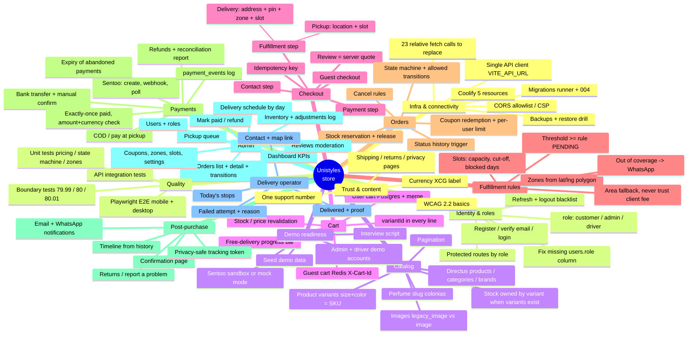

# Prompt: complete implementation of the Unistyles store (mind map + full spec)

> Master prompt to paste into an AI (or load into NotebookLM) so that **nothing is left out** when finishing the website.
> Written 25 Oct 2026 from a direct reading of the code in this repo plus
> `UNISTYLES_Research_Gap_Audit_2026-10-25.md` (UNISTYLES_MASTER/01_Discover/Research_Findings).
> Repo: `unistyles-website-v2`, branch `master`. Copy everything below the line.
>
> Companion prompts: `docs/PROMPT-REBUILD-DATABASE.md` (catalog/database rebuild, owned by another developer)
> and `docs/planning/PROMPT-UML-ERD.md`.

---

## 0. Role and working rules

You are a senior full-stack engineer (React + Node/Express + PostgreSQL + Directus) finishing a **real online
store** for a business in Curaçao. The site must work end to end — browse → variant → cart → checkout →
pickup or delivery → payment → order → tracking → admin → delivery person — so the owner can operate it and
the developer can demo it in job interviews.

Rules:

1. **Work from the code, not from assumptions.** Every claim about current behaviour must cite `file:line`.
   If you cannot confirm something, say "not verified".
2. **Three states, never mixed:** *Implemented* (code exists), *Verified* (a test or manual run proves it),
   *Planned*. Never write "done" for something that has no evidence.
3. **Never hardcode an unapproved business rule.** Thresholds, fees, slots, cut-off, return policy and contact
   numbers live in the `settings` table / admin screen with a default, and are flagged `PENDING APPROVAL` in the
   decision log (§4).
4. **The server is the only source of truth for money.** The browser may display an estimate, but the order total,
   delivery fee, discount and payment amount are always recalculated on the server.
5. **A success screen is not payment proof.** Only a server-side verification against the provider marks an
   order `paid`, exactly once.
6. Keep the existing visual style (inline styles + `styles/main.css`, CSS variables `--muted-gold`, `--cream-bg`,
   `--dark`, Playfair Display headings). Match the surrounding code's naming and comment density.
7. Each change ships with tests (§17). Each phase ends with a short report: what changed, which files, which tests
   pass, what is still pending.

---

## 1. Mind map — the whole system



---

## 2. Current architecture (verified)

- **Frontend** `services/frontend`: React 18 + Vite 5 + React Query + react-router 6, served by nginx.
  27 pages in `src/pages`. Catalog comes **directly from Directus** (`src/services/directusService.js`,
  `src/hooks/useProducts.js`). Cart state: `src/stores/cartStore.js` (+ `services/cartService.js` for sync).
- **Backend** `services/backend`: Express, routes only (`src/controllers/` is empty). Groups: auth, products,
  perfumes, skincare, categories, cart, orders, payments, users, admin, whatsapp, newsletter, reviews, coupons,
  variants, delivery. Socket.IO on `/ws` for payment updates. Helmet, 4 rate limiters, requestId, validateEnv.
- **CMS** Directus 11 owns `products`, `categories`, `brands`, `pages`, `homepage`, `business_settings`.
- **DB** PostgreSQL 16, one database `unistyles_db` shared by Directus and the backend.
  Two schemas exist: `database/init.sql` (v1, 12 tables) and `database/init.v2.sql` (v2, 16 tables — the good one).
  **Production was created with v1** (see `docs/PROMPT-REBUILD-DATABASE.md` §3, phase 4-bis). Target = v2 + migration 004 (§7).
- **Infra** Coolify v4 on a VPS, Plan A = 5 separate resources: postgres, redis, directus (cms.), backend (api.),
  frontend (root domain).

---

## 3. Verified defects that block selling (fix all of them)

| # | Defect | Evidence | Effect |
|---|---|---|---|
| D01 | 23 `fetch('/api/...')` relative calls; the SPA's nginx has no `/api` proxy and returns `index.html` with 200 | `AuthContext.jsx` (6), `Admin.jsx` (5), `Checkout.jsx` (3), `Profile.jsx` (2), `Login.jsx`, `ForgotPassword.jsx`, `Product.jsx` (2), `TrackOrder.jsx`, `PaymentCallback.jsx`, `useDeliveryZones.js`, `services/cartService.js` (`API_URL='/api'`) ; `nginx.conf` | Login, cart sync, coupons, orders, payment, tracking, profile, admin, zones all fail in production. **The shop looks fine but cannot sell.** |
| D02 | `utils/api.js` is the only client using `VITE_API_URL` and nobody imports it; its default is `http://localhost:5000/api` (wrong port) | `src/utils/api.js:2` | Dead code; the correct mechanism is unused. |
| D03 | `users.role` does not exist (schema has `is_admin`) but is selected | `routes/auth.js:295`, `routes/admin.js` (`GET /users/:id`) | `/api/auth/me` and admin user detail throw `column "role" does not exist` → session restore and admin break. |
| D04 | Admin page checks `user.role !== 'admin'`; login returns `role: user.role \|\| 'customer'` → always customer | `pages/Admin.jsx:25`, `routes/auth.js:239` | Admin panel unreachable even for the admin. |
| D05 | Payment method id `bank` in the UI vs `bank_transfer` in the API validator | `src/config.js` `PAYMENT_METHODS`, `routes/orders.js:21` | Bank-transfer orders are rejected with 400. |
| D06 | No pickup option. `shippingAddress.street/city` are mandatory | `routes/orders.js:22-25`, `pages/Checkout.jsx` | Customers who want to collect cannot order; pickup pays a delivery fee. |
| D07 | Delivery zone resolved from a **client-chosen area string**; polygons only exist in the frontend | `routes/orders.js` zone query, `data/curacaoZones.js` | A customer can pick a cheaper area than their real address. |
| D08 | Totals are computed in the browser and shown as final | `Checkout.jsx:51` (`orderTotal`) | Screen total can differ from the charged total. |
| D09 | No delivery date/slot UI; `deliveryDate/deliveryTimeSlot` accepted but never validated (capacity, cut-off, blocked days) | `routes/orders.js`, `Checkout.jsx` | Promises the business cannot keep. |
| D10 | Sizes are hardcoded per category, cart lines have no `variantId`, stock is deducted from `products` even for variant products | `pages/Product.jsx:~131`, `stores/cartStore.js` `addItem`, `routes/orders.js` stock UPDATE | Selling sizes that do not exist; variant stock never moves; oversell. |
| D11 | No idempotency on `POST /api/orders` | `routes/orders.js` | Double click / refresh → duplicate orders and double stock deduction. |
| D12 | Stock is deducted when an unpaid Sentoo order is created and never released if the payment is abandoned/expired | `routes/orders.js`, `routes/payments.js` webhook (`failed` branch) | Phantom out-of-stock. |
| D13 | Webhook marks paid with two separate UPDATEs, no transaction, no row lock, no amount/currency check; the idempotency check is a read-then-write race | `routes/payments.js` webhook + `sentoo-status` | Duplicate notifications, inconsistent order/payment state. |
| D14 | `GET /api/orders/:id` and `PUT /api/orders/:id/cancel` let an anonymous caller read/cancel any order (check only runs `if (req.user && ...)`) | `routes/orders.js` | PII leak + anyone with the UUID can cancel. Cancel also sets `payment_status='refunded'` on unpaid orders. |
| D15 | Tracking by order number only; numbers are sequential | `routes/orders.js` `/track/:orderNumber`, `generate_order_number()` | Order status of strangers is enumerable. |
| D16 | Admin can set any status from any status; statuses limited to `pending…delivered/cancelled` | `routes/admin.js` `PUT /orders/:id` | No pickup states, no failed delivery, impossible transitions allowed. |
| D17 | Coupon: `coupon_id`, `coupon_code`, `delivery_zone_name` not saved; no `coupon_redemptions` row; `max_uses_per_user` not enforced | `routes/orders.js` INSERT | "First order only" coupons reusable; reports incomplete. |
| D18 | `useDeliveryZones` silently falls back to hardcoded fees when the API fails | `hooks/useDeliveryZones.js:3` | Shows fees that may not be the real ones. |
| D19 | Sentoo page is opened with `window.open` after async work | `Checkout.jsx:168` | Popup blockers stop the payment page on mobile. |
| D20 | Catalog: Perfume page asks slug `perfume` but the category is `colonias`; list limit 25 without pagination; list fields omit stock/variants | `pages/Perfume.jsx`, `services/directusService.js` | Perfume page empty; categories truncated. (Data side owned by DB rebuild prompt.) |
| D21 | Two cart implementations, dead backup file, ~1,300 lines of unused product routes | `services/cartService.js` + `stores/cartStore.js`, `data/productData.js.backup-*`, `routes/products.js`/`perfumes.js`/`skincare.js` | Confusion; keep only what the frontend calls. |
| D22 | Zero tests; no `test` script in any `package.json` | all `package.json` | Nothing is verified. |

---

## 4. Business decisions log (defaults are configurable, all `PENDING APPROVAL`)

| ID | Decision | Conflict | Default to implement (setting key) |
|---|---|---|---|
| C01 | Free-delivery threshold | Home says XCG 80; Oct audit says 100 | `free_delivery_threshold = 80`, rule `>=` (`free_delivery_rule = "gte"`), applied to **subtotal after discount**, only for delivery |
| C02 | Zone model | July: 4 areas + out of coverage, no tariffs; Oct: near 10 / far 20 | Keep the 3 seeded zones (5/10/25) editable in admin; per-zone threshold optional; points outside every polygon = `out_of_coverage` → WhatsApp |
| C03 | Source of truth | Directus+Postgres vs Airtable ERP roadmap | Website = Directus (catalog) + Postgres (commerce). Every stock change writes `inventory_movements` so a future ERP can sync |
| C04 | Payment ↔ order correlation | Order after payment vs pending order | **Pending order first** (`awaiting_payment`), stock reserved with expiry, Sentoo transaction id stored on `payments`, webhook verifies and marks paid once |
| C05 | Returns | 7 days (home) vs 48 h complaint for panties | Policy text in settings `return_policy` per category; page reads it |
| C06 | Currency | ANG vs XCG | Code `XCG` everywhere (API, DB, Sentoo); display `XCG` (or `Cg` when approved); 1 ANG = 1 XCG |
| C07 | Support phone | Two numbers in docs | Single setting `support_whatsapp`; all CTAs read it |
| C08 | Pickup | Not defined | `pickup_enabled = true`, one location in `pickup_locations`, slots Mon–Sat |
| C09 | Delivery slots | Not defined | Mon–Sat, 2 windows (10:00–13:00, 14:00–18:00), capacity 8 per window, cut-off 14:00 for next day, `blocked_dates` table |
| C10 | Payment expiry | Not defined | `payment_expiry_minutes = 30` for Sentoo; bank transfer `bank_transfer_expiry_hours = 48` |

Every default is shown in the admin **Settings** screen with a "pending approval" badge until the owner confirms it.

---

## 5. Domain-by-domain specification

For each domain: goal · backend · database · frontend screens & states · acceptance tests.

### 5.1 Infra & connectivity (fixes D01, D02, D18)
- **Frontend:** one module `src/utils/api.js` exporting `API_BASE` (`import.meta.env.VITE_API_URL` without trailing
  slash, empty in dev so the Vite proxy works) and `apiFetch(path, { method, body, auth, headers })` that:
  prefixes `API_BASE`, adds `Authorization` from `localStorage.token`, adds `X-Cart-Id` for guest carts, sends JSON,
  **checks `content-type` is JSON before parsing**, throws an `ApiError {status, message, details}` on non-2xx.
  Replace all 23 relative calls and `cartService.API_URL`. Delete the old dead client.
- `VITE_API_URL` is the API origin (e.g. `https://api.unistylescuracao.com`), paths keep `/api/...`.
- Optional belt-and-braces: nginx `location /api/ { return 502 '{"error":"API not reachable from frontend origin"}'; }`
  with `application/json`, so a misconfigured build fails loudly instead of returning HTML.
- `useDeliveryZones`: no silent fee fallback; on error show "Delivery prices unavailable — contact us on WhatsApp".
- **Test:** build with `VITE_API_URL=https://api.example` and grep the bundle: no `"/api/` string without the origin.

### 5.2 Identity & roles (fixes D03, D04)
- **DB:** `users.role VARCHAR(20) NOT NULL DEFAULT 'customer' CHECK (role IN ('customer','admin','driver'))`;
  backfill `role='admin' WHERE is_admin`; keep `is_admin` in sync by trigger for backward compatibility.
- **Backend:** `middleware/auth.js` → `requireRole(...roles)` re-reading the role from DB (not from the JWT).
  `adminOnly = requireRole('admin')`. `auth.js` login/me/register return the real `role`.
  JWT carries `role` for UI only.
- **Frontend:** `ProtectedRoute` accepts `roles` prop; `/admin` requires `admin`, `/driver` requires `driver|admin`.
  Header shows "Admin" / "Deliveries" link by role.
- **Tests:** customer gets 403 on `/api/admin/*` and `/api/driver/*`; driver gets 403 on admin; `/api/auth/me` 200.

### 5.3 Catalog & variants (fixes D10; data quality lives in the DB rebuild prompt)
- **Backend:** `GET /api/variants/product/:productId` returns only active variants with `size`, `color`, `sku`,
  `stockQuantity`, `price` (= product price + adjustment), `available`.
- **Product page:** if variants exist, sizes and colours come **only** from variants; unavailable combinations are
  disabled with "Out of stock"; the selected variant id, SKU and final price go into the cart line. If no variants,
  product-level stock applies. Size guide modal from `SIZE_CHARTS`. Low-stock badge ≤ 5.
- **Order creation:** when `variantId` is present, lock and decrement `product_variants.stock_quantity`; otherwise
  `products.stock_quantity`. A product with variants cannot be ordered without a `variantId`.
- **Tests:** unavailable variant → 409; variant price adjustment applied; concurrency (two orders for last unit,
  one wins) using `SELECT … FOR UPDATE`.

### 5.4 Cart
- Line shape everywhere: `{ productId, variantId|null, name, sku, price, image, size, color, quantity }`; line key
  = `productId + variantId` (fallback size+color).
- Cart sidebar: quantity +/−, remove, subtotal, **free-delivery progress bar** using the threshold from
  `GET /api/checkout/options`, "Checkout" button. Empty state.
- Revalidation: the checkout quote reports lines whose price changed or stock is insufficient; the UI shows them and
  lets the customer fix quantities.
- **Tests:** add/update/remove persists in localStorage; merge after login; quote flags a stale price.

### 5.5 Checkout (fixes D06, D08, D11, D19)
Steps: **1 Contact → 2 Fulfillment → 3 Payment → 4 Review & place order.**
- Contact: first/last name, email (required for guests, used for confirmation), WhatsApp phone (+599 format hint).
  Logged-in users are prefilled.
- Fulfillment: radio **Pickup** / **Delivery**.
  - Pickup: shows location (name, address, hours, map link), date picker of next 7 open days, slot list with
    remaining capacity; fee XCG 0.
  - Delivery: address autocomplete (Nominatim) + **map pin** (Leaflet `DeliveryMap`) the customer can drag; the
    server resolves the zone from lat/lng (area dropdown only as fallback when no pin); shows zone name, fee,
    ETA, "add XCG x more for free delivery"; out-of-coverage state with WhatsApp CTA; date + slot picker.
- Payment: methods from `GET /api/checkout/options` (`cod` is labelled "Pay at pickup" when pickup), Sentoo,
  bank transfer, WhatsApp order. Disabled methods hidden.
- Review: everything comes from `POST /api/checkout/quote` (re-requested whenever cart, coupon, fulfillment,
  location or slot changes; debounced). Coupon input lives here and in the summary.
- Place order: `POST /api/orders` with header `Idempotency-Key` (UUID generated once per checkout session, stored in
  sessionStorage). Button disabled while submitting.
- Sentoo: open a blank tab **synchronously on click**, then set its location when the payment URL arrives; if
  blocked, show a "Pay now" button + QR on the callback page.
- After success: navigate to `/order/:orderNumber?t=<trackingToken>` (confirmation page), clear cart.
- **States to render:** loading quote, quote error, slot full, zone out of coverage, coupon invalid/expired/min
  amount, stock changed, network error, submitting, duplicate submit (same key returns the same order).

### 5.6 Fulfillment rules (fixes D07, D09)
- **DB:** `pickup_locations(id, name, address, lat, lng, hours, instructions, is_active)`;
  `fulfillment_slots(id, method 'pickup'|'delivery', weekday 0-6, start_time, end_time, capacity, is_active)`;
  `blocked_dates(date, method NULL=both, reason)`; `delivery_zones.polygon` filled with GeoJSON from
  `data/curacaoZones.js` (move the polygons to the server; the frontend reads them from the API for the map).
- **Backend `services/fulfillment.js`:** `findZoneByPoint(lat,lng)` (ray casting, multipolygon),
  `findZoneByArea(area)`, `availableSlots(method, fromDate, days)` → for each date: open? blocked? cut-off passed?
  remaining = capacity − active orders in that slot (statuses not cancelled/expired).
- **Endpoints:** `GET /api/delivery/zones` (now with polygons), `GET /api/delivery/resolve?lat&lng|area`,
  `GET /api/delivery/slots?method=pickup|delivery&days=7`, `GET /api/delivery/pickup-locations`.
- Order creation re-checks slot capacity **inside the transaction** (`SELECT … FOR UPDATE` on the slot row).
- **Tests:** point inside each zone; point in the sea → out of coverage; cut-off at 13:59 vs 14:00; full slot
  rejected; blocked date hidden; pickup fee always 0.

### 5.7 Orders & state machine (fixes D14, D16, D17)
```
pending ──► awaiting_payment ──► confirmed ──► processing ──┬─► ready_for_pickup ──► picked_up
   │               │   (expired/failed)                      └─► out_for_delivery ──► delivered
   │               ▼                                                    │
   └────────► cancelled ◄──────────── (admin, before dispatch)          └─► delivery_failed ──► out_for_delivery (retry)
                                                                                   └──────────► returned
paid orders cancelled → refund flow → payment_status refunded
```
- `services/orderState.js`: `TRANSITIONS` map, `canTransition(from,to,{fulfillment, paymentStatus})`,
  `assertTransition`. Rule: `processing` and later require `payment_status IN ('paid','pending_delivery')`
  (COD / pay at pickup) — audit rule "preparation cannot begin without confirmed payment".
  `ready_for_pickup`/`picked_up` only for pickup; `out_for_delivery`/`delivered`/`delivery_failed` only for delivery.
- Status history: existing trigger + `changed_by` and `note` set via `SET LOCAL app.user_id` / explicit insert.
- Cancel: customer may cancel own order only while `pending|awaiting_payment|confirmed` and not dispatched;
  guests need the tracking token; stock released via `inventory_movements`; payment → `cancelled` if unpaid,
  `refund_pending` flag for admin if paid.
- `GET /api/orders/:id` requires owner, admin, or valid tracking token.
- Coupon: save `coupon_id`, `coupon_code`, insert `coupon_redemptions`, enforce `max_uses_per_user` by user id or
  guest email.

### 5.8 Payments (fixes D12, D13)
- Methods: `cod` (cash on delivery / pay at pickup) → order `confirmed`, payment `pending_delivery`; collected when
  driver/admin marks delivered/picked up (`payment → paid`, `paid_at`).
  `bank_transfer` → `awaiting_payment`, instructions with reference = order number, admin "Mark as paid" after
  checking the bank, expiry 48 h. `whatsapp` → `pending`, staff confirm in admin. `sentoo` → `awaiting_payment`.
- **Sentoo exactly-once:** `services/payments.js#confirmSentooPayment(transactionId, source)`:
  one transaction → `SELECT payment … FOR UPDATE` → if already `paid` return → fetch status from Sentoo (never trust
  the webhook body) → verify `amount == round(total*100)` and `currency == 'XCG'` (mismatch → `failed`,
  `failure_reason='amount_mismatch'`, alert admin) → `UPDATE payments SET status='paid', paid_at` and
  `UPDATE orders SET payment_status='paid', status='confirmed' WHERE payment_status <> 'paid'` → commit → only then
  notifications + socket emit. Webhook, status poll and admin "re-check" all call this function.
- `payment_events(id, payment_id, source 'webhook'|'poll'|'admin'|'system', provider_status, payload, created_at)`
  logs every callback (replays are visible).
- Expiry job (`jobs/expirePayments.js`, every 5 min, `setInterval` with a Postgres advisory lock): orders
  `awaiting_payment` older than expiry → order `cancelled`, payment `expired`, stock released, Sentoo cancel call.
  A late success webhook for an expired order → mark `paid` + flag `needs_review` (never lose money silently).
- Mock mode for demos: `PAYMENTS_MODE=mock` (only when `NODE_ENV!=='production'` or explicitly allowed) — a local
  page `/payment/mock/:orderId` with Approve / Decline / Abandon buttons that calls the same confirm function.
- Refunds: admin action records refund (amount, reason, method) in `refunds` table; payment `refunded` /
  `partially_refunded`; Sentoo refunds are done in the Sentoo dashboard (API not used) and recorded here.
- Reconciliation report: `GET /api/admin/payments?from&to&status&method` + CSV export; totals per method/day.
- **Tests:** webhook replay ×3 → one paid transition, one notification; amount mismatch → not paid; expiry releases
  stock; late webhook after expiry flagged; refresh of callback page does not change totals.

### 5.9 Post-purchase: confirmation & tracking (fixes D15)
- `orders.tracking_token` (random 24 chars, unique). Confirmation page `/order/:orderNumber?t=` shows items,
  totals, fulfillment (pickup location+slot or address+slot), payment status with next step (bank details,
  "pay now" for Sentoo, cash amount), timeline from `order_status_history`, WhatsApp help link.
- `GET /api/orders/track/:orderNumber?t=token` or `?phone=last4` → status, fulfillment summary, timeline (no
  address, no email). `TrackOrder.jsx` asks order number + last 4 digits of phone.
- Profile → "My orders" links to the same page.

### 5.10 Notifications
- Existing `utils/notifications.js` (email via nodemailer, WhatsApp Cloud API). Events: order placed, paid, ready
  for pickup, out for delivery, delivered, delivery failed, cancelled, refunded. Each call is fire-and-forget,
  logged in `whatsapp_messages`; failure never breaks the request. Templates include tracking link.

### 5.11 Admin panel (`/admin`, role admin)
Tabs, each with loading / empty / error states:
1. **Dashboard:** today's orders, revenue (paid only), awaiting payment, to prepare, today's deliveries, today's
   pickups, low-stock count, orders by status.
2. **Orders:** filters (status, payment status, method, fulfillment, date, search by number/name/phone), table,
   detail drawer: items, totals, customer, fulfillment, payment + events, timeline, admin notes, buttons only for
   allowed transitions, "Mark paid", "Re-check Sentoo", "Refund", "Print packing slip", WhatsApp customer.
3. **Schedule:** by date — delivery slots with their orders (assign driver), pickup slots with their orders.
4. **Inventory:** products with variants, stock edit with reason (restock / manual sale / WhatsApp sale /
   correction) → `inventory_movements`; low-stock filter; movement history.
5. **Payments:** reconciliation list + CSV export.
6. **Settings:** threshold, rule, zones (fee, threshold, active), slots, blocked dates, pickup location, expiry,
   support phone, return policy — each with "pending approval" badge.
7. **Coupons** (existing API), **Users** (role change), **Reviews** (approve/reject).

### 5.12 Delivery operator (`/driver`, role driver|admin)
- Today's stops (orders `out_for_delivery` assigned to me, or all for admin), ordered by slot: name, phone (tap to
  call / WhatsApp), address + landmark, Google Maps link from lat/lng, amount to collect (COD).
- Actions: "Start route" (processing → out_for_delivery), "Delivered" (recipient name, optional note, COD collected
  checkbox) → `delivery_attempts` row + order `delivered` (+ payment paid for COD), "Failed" (reason: not home /
  wrong address / refused / other) → `delivery_failed`.
- **DB:** `orders.assigned_driver_id`, `delivery_attempts(id, order_id, driver_id, outcome, reason,
  recipient_name, note, cod_collected, created_at)`. Photo proof is out of scope until privacy rules are approved.

### 5.13 Customer account
Profile edit, password change, saved addresses (with lat/lng + zone), order list with status chips, link to order
page, reorder button (adds same variants to cart if available).

### 5.14 Trust, content & accessibility
One support number from settings; Shipping page reads zones/threshold/slots from API (no hardcoded numbers);
Returns policy from settings; Privacy page mentions data kept (order, contact) and Curaçao law (legal review
pending); all forms have labels, errors in text (not colour only), focus visible, buttons ≥ 44px, `lang` attribute.

### 5.15 Measurement
`src/utils/analytics.js` with `track(event, props)` (console in dev, no third party until consent decided).
Events: `search`, `view_item`, `select_variant`, `add_to_cart`, `begin_checkout`, `select_fulfillment`,
`add_payment_info`, `purchase`, `payment_failed`.

### 5.16 Security & privacy
Orders readable only by owner/admin/token; rate-limit tracking and quote endpoints; validate every body with
express-validator; never log full card/bank data; admin notes never returned to customers; CORS allowlist from env;
secrets only in Coolify env; `COOLIFY-SECRETOS-produccion.txt` must not be committed (check `.gitignore`).

### 5.17 Testing
- Backend: `node --test` (no extra dependency) in `services/backend/test/`:
  `pricing.test.js` (subtotal, coupon %, cap, fixed, threshold boundaries 79.99/80/80.01 and per-zone 74.99/75,
  pickup fee 0, discount before threshold), `orderState.test.js` (every allowed and forbidden transition),
  `fulfillment.test.js` (zones by point, cut-off, capacity, blocked dates), `payments.test.js` (confirm function with
  a fake DB client: replay, mismatch, late webhook).
- API integration (optional, needs Postgres): `test/integration/*.test.js` guarded by `TEST_DATABASE_URL`.
- E2E Playwright (`e2e/`): guest pickup + COD; guest delivery + Sentoo mock approve; Sentoo decline → retry;
  coupon; out-of-coverage pin; admin moves order to ready → picked up; driver marks delivered; mobile viewport.
- `package.json` scripts: `test`, `test:e2e`.

### 5.18 Deployment
Migration `004_fulfillment_payments_roles.sql` (idempotent, `IF NOT EXISTS`); fix duplicate `001_*` numbering by
renaming one to `001b_*` only if `schema_migrations` in production does not already list it (check first).
New env: `PAYMENTS_MODE` (`sentoo`|`mock`), `PAYMENT_EXPIRY_MINUTES`. Frontend build arg `VITE_API_URL` must be set
in Coolify. Smoke test after deploy: `curl -s https://api…/health`, `curl -sI https://unistylescuracao.com/` and a
quote request from the browser console.

### 5.19 Demo readiness (interviews)
`database/seed-demo.sql`: demo admin (`admin@demo.unistyles`), driver (`driver@demo.unistyles`), customer,
3 products with variants if Directus is empty is **not** allowed (catalog belongs to Directus) — instead the seed
adds variants/stock for existing product ids and a few sample orders in every status. README section "Run the demo
locally" (`docker compose up`, migrate, seed, `PAYMENTS_MODE=mock`). Interview script: audit §14.

### 5.20 Cleanup
Remove `data/productData.js.backup-*`; merge `cartService.js` into the store or keep it as the only sync layer;
mark unused product/perfume/skincare routes as legacy (or remove after confirming no caller besides
`/api/perfumes/quiz/results`).

---

## 6. API contract (target)

| Method & path | Auth | Purpose |
|---|---|---|
| `GET /api/checkout/options` | public | threshold, rule, payment methods enabled, pickup enabled, delivery enabled, currency, support phone |
| `POST /api/checkout/quote` | optional | body `{items[], fulfillment:{method, lat, lng, area, pickupLocationId, date, slotId}, couponCode}` → `{lines[], subtotal, discount, deliveryFee, total, currency, zone, freeDelivery:{threshold, remaining, qualifies}, coupon:{valid, code, error}, issues[]}` |
| `POST /api/orders` | optional, `Idempotency-Key` header | creates order from the same quote logic; returns `{order, trackingToken, next:{type:'redirect'|'instructions'|'confirmation', …}}` |
| `GET /api/orders/:id` | owner/admin/token | detail |
| `GET /api/orders/by-number/:orderNumber?t=` | token | confirmation page payload |
| `GET /api/orders/track/:orderNumber?t=|phone=` | public, rate-limited | status + timeline |
| `PUT /api/orders/:id/cancel` | owner/token/admin | cancel within rules |
| `GET /api/delivery/zones` · `/resolve` · `/slots` · `/pickup-locations` | public | fulfillment data |
| `POST /api/payments/sentoo` | token/owner | create or reuse transaction |
| `POST /api/payments/sentoo/webhook` | Sentoo | always 200 |
| `GET /api/payments/:orderId/sentoo-status` | public by UUID | poll → uses confirm function |
| `POST /api/payments/mock/:orderId` | mock mode only | `{outcome:'approve'|'decline'|'abandon'}` |
| `GET /api/admin/stats` | admin | KPIs |
| `GET /api/admin/orders` · `GET /api/admin/orders/:id` | admin | list (filters) / detail with items, payments, events, history, attempts |
| `POST /api/admin/orders/:id/transition` | admin | `{to, note}` validated by state machine |
| `POST /api/admin/orders/:id/mark-paid` · `/refund` · `/recheck-payment` · `/assign-driver` | admin | payment ops |
| `GET /api/admin/schedule?date=` | admin | slots with orders |
| `GET /api/admin/inventory` · `POST /api/admin/inventory/adjust` · `GET /api/admin/inventory/movements` | admin | stock |
| `GET /api/admin/payments` (+ `?format=csv`) | admin | reconciliation |
| `GET/PUT /api/admin/settings` · CRUD `/api/admin/slots`, `/api/admin/blocked-dates`, `/api/admin/zones/:id`, `/api/admin/pickup-locations/:id` | admin | configuration |
| `GET/PUT /api/admin/users…` (role) | admin | users |
| `GET /api/driver/stops?date=` · `POST /api/driver/orders/:id/start|delivered|failed` | driver/admin | operator app |

Error format everywhere: `{ error: string, code?: string, details?: [] }` with proper HTTP status (400 validation,
401, 403, 404, 409 conflict/stock/slot full, 422 business rule, 503 provider not configured).

---

## 7. Database migration 004 (on top of v2)

1. `users.role` + backfill + sync trigger.
2. `orders`: `fulfillment_method` (`'delivery'|'pickup'`, default `'delivery'`), `pickup_location_id`,
   `fulfillment_date`, `fulfillment_slot_id`, `tracking_token UNIQUE`, `idempotency_key UNIQUE`,
   `assigned_driver_id`, `payment_expires_at`, `needs_review BOOLEAN`, `shipping_address` nullable for pickup
   (CHECK: delivery ⇒ address not null). Extend status CHECK with `ready_for_pickup, picked_up,
   out_for_delivery, delivery_failed, returned, expired`; map legacy `shipped` → `out_for_delivery`.
   Extend payment_status CHECK with `partially_refunded`.
3. New tables: `pickup_locations`, `fulfillment_slots`, `blocked_dates`, `payment_events`, `refunds`,
   `delivery_attempts`, `inventory_movements`.
4. Settings seed for every key in §4.
5. Zone polygons into `delivery_zones.polygon`.
6. Indexes: slot occupancy `(fulfillment_date, fulfillment_slot_id) WHERE status NOT IN ('cancelled','expired')`,
   `payments(status, created_at)`, `orders(payment_expires_at) WHERE status='awaiting_payment'`.

---

## 8. Screen inventory (Figma ↔ code ↔ requirement)

| # | Screen | Route / component | States |
|---|---|---|---|
| 1 | Home | `/` `Home.jsx` | hero, categories, delivery rule from API, WhatsApp |
| 2 | Category / search | `Category.jsx`, `Search.jsx` | loading, empty, no stock, filters |
| 3 | Product detail | `Product.jsx` | variant picker, unavailable, low stock, size guide |
| 4 | Cart | `CartSidebar.jsx` | empty, items, free-delivery progress, error |
| 5 | Checkout | `Checkout.jsx` | 4 steps + all states in §5.5 |
| 6 | Payment | `PaymentCallback.jsx`, mock page | processing, success, declined, abandoned, expired, retry |
| 7 | Confirmation & tracking | `OrderDetail.jsx` (`/order/:n`), `TrackOrder.jsx` | timeline, next step per method |
| 8 | Customer service / returns | `Contact.jsx`, `Shipping.jsx`, `FAQ.jsx` | policy by category |
| 9 | Admin | `Admin.jsx` + `components/admin/*` | 7 tabs (§5.11) |
| 10 | Delivery operator | `Driver.jsx` | stops, delivered, failed |

---

## 9. Order of work (each phase = one PR, tests green)

1. **P0 Connectivity & auth:** §5.1, §5.2, D05. DoD: login works against `VITE_API_URL`, admin reachable.
2. **P0 Money core:** migration 004, `pricing.js`, `fulfillment.js`, `orderState.js`, `/checkout/options|quote`,
   new `POST /orders`, unit tests. DoD: `npm test` green, boundary tests pass.
3. **P0 Payments:** confirm function, webhook/poll refactor, expiry job, mock mode, payment_events. DoD: replay test.
4. **P1 Checkout UI** (§5.5) + variants on product page (§5.3) + cart progress bar.
5. **P1 Confirmation/tracking** (§5.9) + cancel rules.
6. **P1 Admin** (§5.11) + **Driver** (§5.12).
7. **P2** content/trust, analytics, cleanup, Playwright, demo seed, README.

---

## 10. Release acceptance checklist (from the audit §9 — mark Not checked / Failed / Passed + date + evidence)

Money & order integrity: real variant → correct SKU/price/stock in cart · unavailable variant not purchasable ·
no oversell on concurrent last unit · cart recalculation · guest and logged-in checkout · fulfillment change refreshes
server total · one currency and threshold everywhere · Sentoo test produces exactly one paid order · cancel / fail /
timeout / replay / refresh never create extra paid orders · refund + reconciliation documented.
Delivery & operations: pickup has no fee and a real slot · in/out of coverage by location, not by label · slots
respect capacity, cut-off, blocked days · final price and window visible before paying · no preparation without
payment rule · staff can change states, report failed delivery, confirm handover · manual/WhatsApp sales update the
same stock.
Trust & resilience: consistent contact/returns/shipping promises · privacy and access control · restore drill ·
automated checkout tests on mobile and desktop.

---

## 11. Output expected from you (the AI)

For every phase: (1) list of files created/changed, (2) the code, (3) migration SQL, (4) tests and their output,
(5) what is still *Planned* or *Pending approval*, (6) manual steps for Coolify. Do not skip states, error paths or
tests to save time. If something in this prompt contradicts the code, the code wins — report the contradiction.
